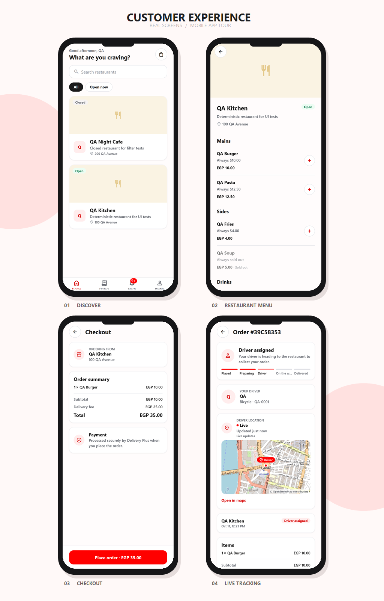

<p align="center">
  
  &nbsp;&nbsp;
  
</p>

<h1 align="center">Delivery Plus Customer App</h1>

<p align="center">Browse restaurants, build a cart, check out and follow every order through delivery.</p>

<p align="center">
  <strong>DELIVERY PLUS</strong>
  &nbsp; × &nbsp;
  <a href="https://expo.dev"></a>
</p>

<p align="center">
  <a href="https://github.com/Delivery-Plus0/delivery-plus-customer-app"></a>
  
  
  
</p>

Built with **Expo 57 / React Native 0.86 / Expo Router / TypeScript**, and runs on Android, iOS and the web. The app talks only to the Delivery Plus API gateway. The backend (12 NestJS services, PostgreSQL, Redis, Kafka) lives in [Delivery-Plus0/delivery-plus](https://github.com/Delivery-Plus0/delivery-plus).

## App gallery

<p align="center">
  <a href="./identity/mobile-screens.png"></a>
</p>

Four real screens from the running app, presented in rounded phone frames. Captured at phone width from the web build with seeded QA data.

## Features

| Area | What works |
| --- | --- |
| Account | Sign up, sign in (one request per submit, actionable errors), profile with avatar and delivery address |
| Browse | Restaurant list and search, restaurant page with menu |
| Cart and checkout | One-restaurant cart, quantity changes, checkout with order + payment (idempotency keys, so retries never double-charge) |
| Orders | Order history, and a **live order screen** led by the current phase: placed → preparing → **finding a driver** (with how long it has been searching) → driver assigned (driver card: first name, photo, vehicle, plate) → picked up → on the way → delivered. Cancel while allowed, with the rule shown |
| Driver on the map | While a delivery is in progress the order screen shows a street map with the driver's pin, labelled **Live** or **Last known location**, updated in real time with polling as fallback (see below) |
| Notifications | In-app notifications with an unread badge, one per order stage |

The drop-off address comes from the customer's profile at checkout (the backend copies it onto the order). Dispatch is automatic on the backend, so the delivery card goes from "Finding a driver" to "Driver assigned" by itself.

### Driver tracking on the order screen

The "Driver location" card follows the backend's tracking state (`GET /api/tracking/delivery/:id`, see the backend's `docs/services/tracking-service.md`). The state is the only input; the app never guesses it from a missing location:

| Backend `tracking` | The card shows |
| --- | --- |
| `NO_DRIVER` | "Finding a driver", no map |
| `AWAITING_LOCATION` | "Driver assigned · Waiting for location…", no map |
| `LIVE` | "Live · Updated 8 s ago", map with a red **Driver** pin at the reported position |
| `STALE` (no report for over 60 s) | "Last known location · Updated 4 min ago", dimmed map with a grey pin |
| `ENDED` (delivered or cancelled) | nothing: the card and the driver's position are gone |

- **Bad data:** invalid or missing coordinates show "location unavailable" and no pin.
- **Disconnected:** the last position stays on screen as **Last known location · reconnecting…**, never as "Live". This covers a failed refresh (offline, timeout, server error) and a dropped realtime stream with no successful refresh since.
- **The map:** OpenStreetMap raster tiles drawn with `expo-image`, centred on the driver, so there is no native map SDK, no API key and the same behaviour on every platform.
  - If tiles fail to load, the pin and the status still show.
  - Set `EXPO_PUBLIC_MAP_TILE_URL` to a proper tile provider in production.
  - There is no route, ETA or animated movement: the pin is exactly where the driver last reported.
- **Realtime, with polling as fallback (Phase 7 Step 3, #136):**
  - **The stream:** while the order screen is focused, `useDeliveryTracking` subscribes to `GET /api/tracking/delivery/:id/stream` (Server-Sent Events, read with `expo/fetch` streaming on native and web, authenticated with the session token). Each pushed snapshot is merged into the same cache entry the card reads, so the map moves as soon as the driver reports.
  - **Captions:** under the status:
    - **Live updates**: the stream is open.
    - **Reconnecting…**: it dropped and nothing fresh has arrived since.
    - **Updating every 10 s**: fallback polling is keeping the data fresh.
  - **Fallback:** the existing 10 s polling runs **only while the stream isn't open**, and stops again as soon as it reconnects.
  - **Reconnect:** a network error, a server close, an `error` event or 40 s without any byte (the server pings every 15 s) means the stream is gone. Retries wait 1, 2, 5, 10, 20, then 30 s (capped), one connection at a time, until the screen is left.
  - **When it stops:** on `ENDED`, on 401/403/404 (polling continues), on blur or unmount.
  - **Ordering:** pushed and polled snapshots both go through `mergeTracking`. For the same driver, an older position never replaces a newer one, and `ENDED` is final. The "Updated … ago" age keeps counting locally between pushes.
  - **Layers:** `services/tracking-stream.ts` (transport) → `state/tracking-realtime.ts` (connection state machine) → `state/tracking.ts` (data source) → `utils/tracking.ts` (`describeTracking`, the single state → UI mapping) → `components/driver-location-card.tsx` / `tracking-map.tsx`.
  - **Scope:** only this tracking card is realtime; the rest of the app still polls.

## Getting started

Requirements: Node.js 22, and the backend dev stack running locally (see the backend README; the gateway listens on `http://localhost:3000`).

```bash
cp .env.example .env.local     # EXPO_PUBLIC_API_BASE_URL=http://localhost:3000
npm ci
npm run web                    # or: npm start  (Expo Go / emulator)
```

On an Android emulator use `http://10.0.2.2:3000`; on a physical device use your machine's LAN IP. Development builds show the API URL on the sign-in screen.

Demo account (after `npm run seed:demo` in the backend): `demo.customer@example.com` / `password123`.

## Project structure

```text
src/
├── app/            Expo Router screens: (auth) welcome·sign-in·sign-up, (app)/(tabs) home·orders·notifications·profile, checkout, order/[id], restaurant/[id]
├── components/     UI building blocks (cards, delivery card, form inputs, alerts)
├── services/       API client (api.ts: timeouts, auth header, error mapping) and one module per backend resource
├── state/          Data hooks on top of useResource (cart, orders, deliveries, notifications, catalog, profile)
├── hooks/          useResource (cache, polling, in-flight dedupe), theme and debounce hooks
├── config/         API base URL
├── utils/          Formatting and small pure helpers (unit-tested)
└── test/           Test setup
e2e/                Maestro flows (smoke, regression, business) and the runner
.project-context/   Architecture and contract notes for contributors and AI agents
planning.md         Status, current sprint and roadmap for the app and the backend it depends on
```

## Testing

| Level | Command |
| --- | --- |
| Typecheck | `npm run typecheck` |
| Lint (zero warnings) | `npm run lint` |
| Unit tests (vitest) | `npm test` |
| UI / E2E (Maestro, web) | `node e2e/scripts/run.mjs --suite smoke --build --headless` against the backend's isolated E2E stack (`npm run e2e:env:reset` in the backend repo) |

The E2E suites cover the customer journey (smoke), failure paths, authorization and offline recovery (regression), and the full order → delivery cycle (business). See [e2e/README.md](e2e/README.md).

## CI

| Workflow | What it proves |
| --- | --- |
| CI | `npm ci`, typecheck, lint, unit tests, web export (catches broken imports and render-time errors) |
| E2E (Maestro) | Pull requests: smoke suite against the backend E2E stack. Nightly and manual: every suite |
| Security | CodeQL, `npm audit` (blocks on critical) and a Trivy filesystem/secret scan |

## Branches and contributing

`dev` is the default branch; `testing` is protected; `main` holds releases. See [CONTRIBUTING.md](CONTRIBUTING.md), [SECURITY.md](SECURITY.md) and [CODE_OF_CONDUCT.md](CODE_OF_CONDUCT.md).

## License

See [LICENSE](LICENSE).
