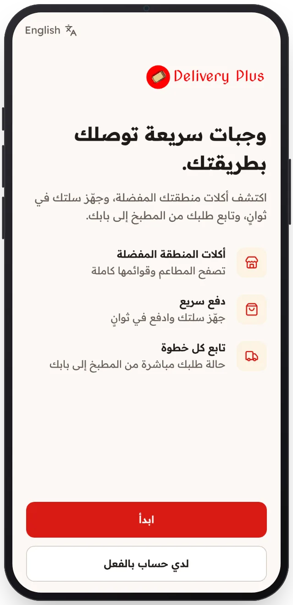

<!-- Generated from the app's web build (screens in docs/screens); regenerate rather than edit by hand. -->

[تطبيق العميل](../../../README.md) › [الشاشات](../README.md) › 1 من 13 · [English](../en/01-welcome.md)

<h1 align="center">مرحبًا</h1>

أول تشغيل: سجّل الدخول أو أنشئ حسابًا لتبدأ الطلب.

→ السابق &nbsp;·&nbsp; <b>1 / 13</b> &nbsp;·&nbsp; <a href="02-sign-in.md">التالي ←</a>

