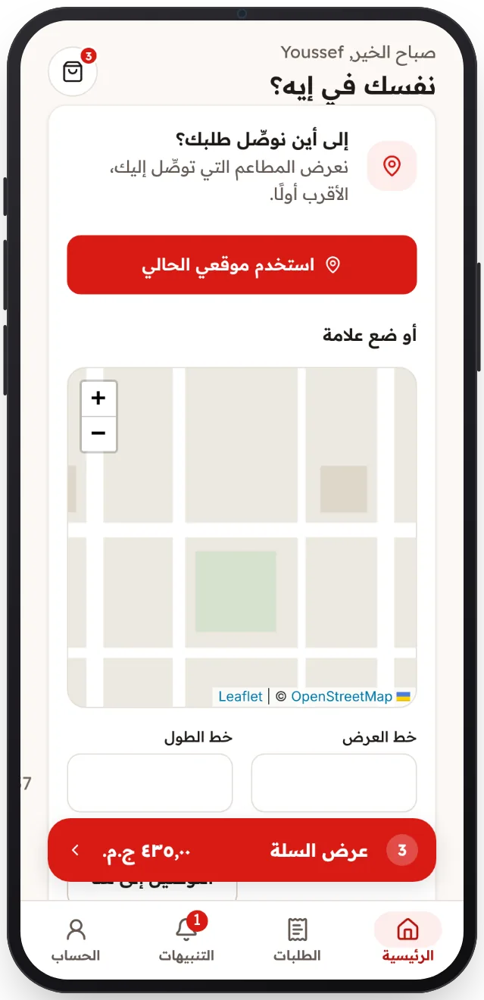

<!-- Generated from the app's web build (screens in docs/screens); regenerate rather than edit by hand. -->

[تطبيق العميل](../../../README.md) › [الشاشات](../README.md) › 3 من 13 · [English](../en/03-delivery-location.md)

<h1 align="center">إلى أين نوصّل؟</h1>

موقعك الحالي أو علامة على الخريطة يحددان المطاعم التي تظهر لك.

<a href="02-sign-in.md">→ السابق</a> &nbsp;·&nbsp; <b>3 / 13</b> &nbsp;·&nbsp; <a href="04-home.md">التالي ←</a>

