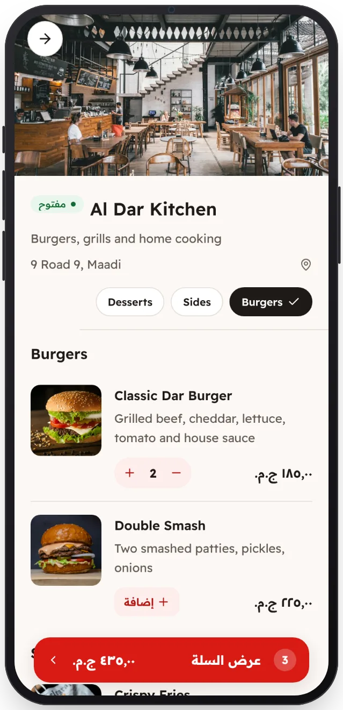

<!-- Generated from the app's web build (screens in docs/screens); regenerate rather than edit by hand. -->

[تطبيق العميل](../../../README.md) › [الشاشات](../README.md) › 5 من 13 · [English](../en/05-restaurant.md)

<h1 align="center">قائمة الطعام</h1>

الأقسام والأسعار والأصناف النافدة، والإضافة إلى السلة بلمسة.

<a href="04-home.md">→ السابق</a> &nbsp;·&nbsp; <b>5 / 13</b> &nbsp;·&nbsp; <a href="06-cart.md">التالي ←</a>

