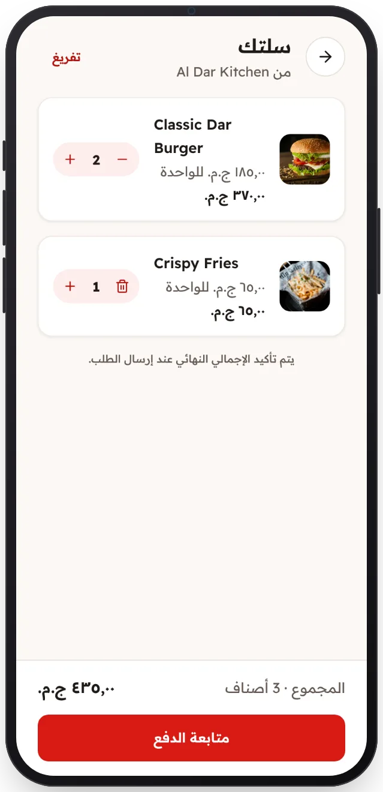

<!-- Generated from the app's web build (screens in docs/screens); regenerate rather than edit by hand. -->

[تطبيق العميل](../../../README.md) › [الشاشات](../README.md) › 6 من 13 · [English](../en/06-cart.md)

<h1 align="center">السلة</h1>

غيّر الكميات ويتحدّث المجموع.

<a href="05-restaurant.md">→ السابق</a> &nbsp;·&nbsp; <b>6 / 13</b> &nbsp;·&nbsp; <a href="07-checkout.md">التالي ←</a>

