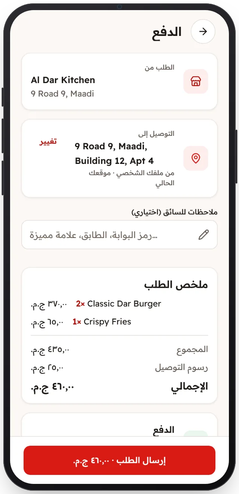

<!-- Generated from the app's web build (screens in docs/screens); regenerate rather than edit by hand. -->

[تطبيق العميل](../../../README.md) › [الشاشات](../README.md) › 7 من 13 · [English](../en/07-checkout.md)

<h1 align="center">إتمام الطلب</h1>

عنوان وموقع التوصيل والملاحظات، والإجمالي مع رسوم التوصيل من الخادم.

<a href="06-cart.md">→ السابق</a> &nbsp;·&nbsp; <b>7 / 13</b> &nbsp;·&nbsp; <a href="08-order-preparing.md">التالي ←</a>

