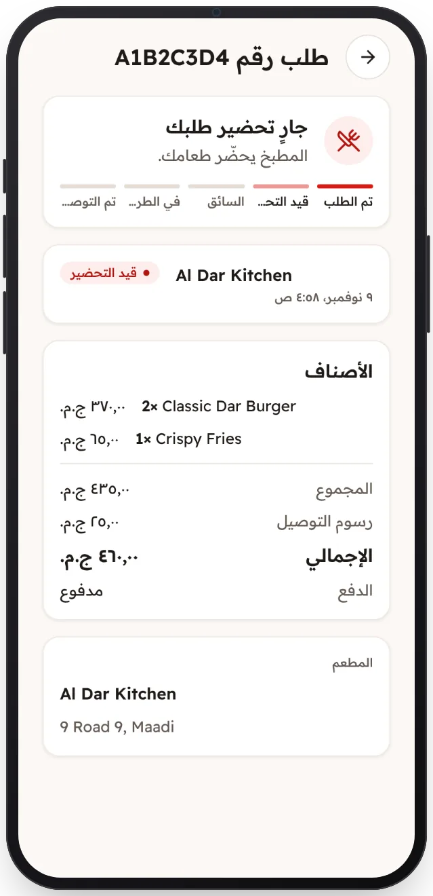

<!-- Generated from the app's web build (screens in docs/screens); regenerate rather than edit by hand. -->

[تطبيق العميل](../../../README.md) › [الشاشات](../README.md) › 8 من 13 · [English](../en/08-order-preparing.md)

<h1 align="center">الطلب: قيد التحضير</h1>

كل مرحلة من مراحل الطلب مباشرةً أثناء تحضيره.

<a href="07-checkout.md">→ السابق</a> &nbsp;·&nbsp; <b>8 / 13</b> &nbsp;·&nbsp; <a href="09-order-on-the-way.md">التالي ←</a>

