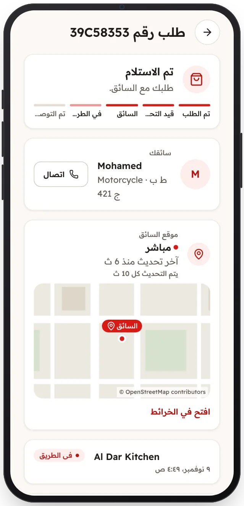

<!-- Generated from the app's web build (screens in docs/screens); regenerate rather than edit by hand. -->

[تطبيق العميل](../../../README.md) › [الشاشات](../README.md) › 9 من 13 · [English](../en/09-order-on-the-way.md)

<h1 align="center">في الطريق</h1>

موقع السائق مباشرةً على الخريطة، وزر للاتصال به.

<a href="08-order-preparing.md">→ السابق</a> &nbsp;·&nbsp; <b>9 / 13</b> &nbsp;·&nbsp; <a href="10-order-delivered.md">التالي ←</a>

