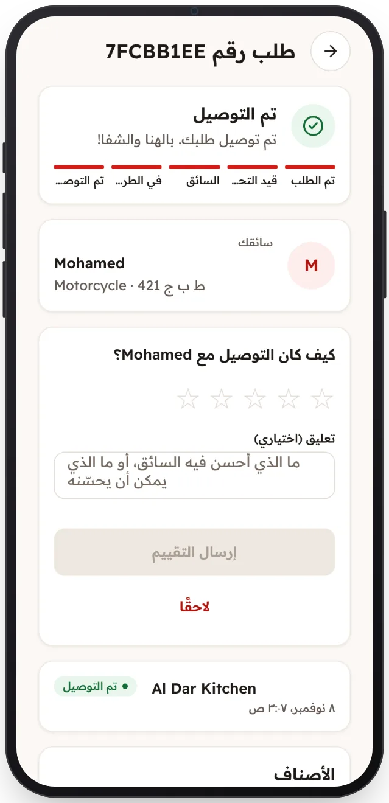

<!-- Generated from the app's web build (screens in docs/screens); regenerate rather than edit by hand. -->

[تطبيق العميل](../../../README.md) › [الشاشات](../README.md) › 10 من 13 · [English](../en/10-order-delivered.md)

<h1 align="center">تم التوصيل</h1>

الفاتورة، وتقييم السائق.

<a href="09-order-on-the-way.md">→ السابق</a> &nbsp;·&nbsp; <b>10 / 13</b> &nbsp;·&nbsp; <a href="11-orders.md">التالي ←</a>

