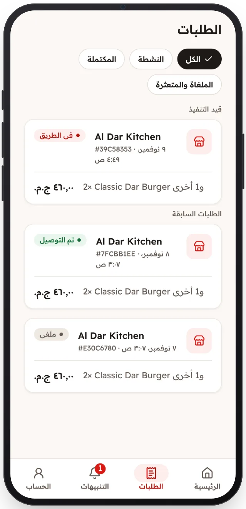

<!-- Generated from the app's web build (screens in docs/screens); regenerate rather than edit by hand. -->

[تطبيق العميل](../../../README.md) › [الشاشات](../README.md) › 11 من 13 · [English](../en/11-orders.md)

<h1 align="center">الطلبات</h1>

الطلبات الحالية والسابقة، مع توضيح الإلغاء والاسترداد.

<a href="10-order-delivered.md">→ السابق</a> &nbsp;·&nbsp; <b>11 / 13</b> &nbsp;·&nbsp; <a href="12-notifications.md">التالي ←</a>

