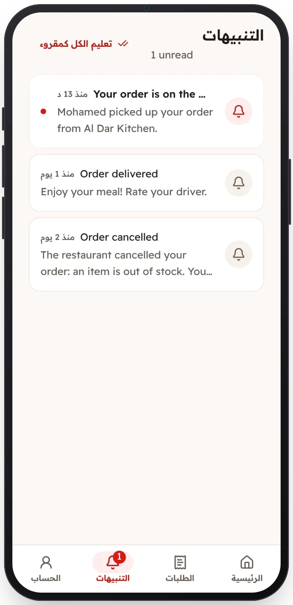

<!-- Generated from the app's web build (screens in docs/screens); regenerate rather than edit by hand. -->

[تطبيق العميل](../../../README.md) › [الشاشات](../README.md) › 12 من 13 · [English](../en/12-notifications.md)

<h1 align="center">الإشعارات</h1>

كل تغيير في حالة الطلب.

<a href="11-orders.md">→ السابق</a> &nbsp;·&nbsp; <b>12 / 13</b> &nbsp;·&nbsp; <a href="13-profile.md">التالي ←</a>

