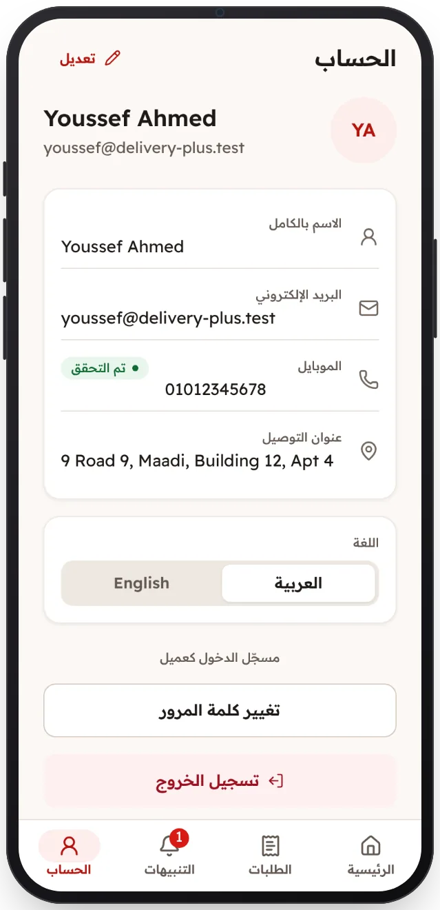

<!-- Generated from the app's web build (screens in docs/screens); regenerate rather than edit by hand. -->

[تطبيق العميل](../../../README.md) › [الشاشات](../README.md) › 13 من 13 · [English](../en/13-profile.md)

<h1 align="center">الملف الشخصي</h1>

الاسم والصورة والهاتف الموثّق والعنوان وكلمة المرور واللغة.

<a href="12-notifications.md">→ السابق</a> &nbsp;·&nbsp; <b>13 / 13</b> &nbsp;·&nbsp; التالي ←

