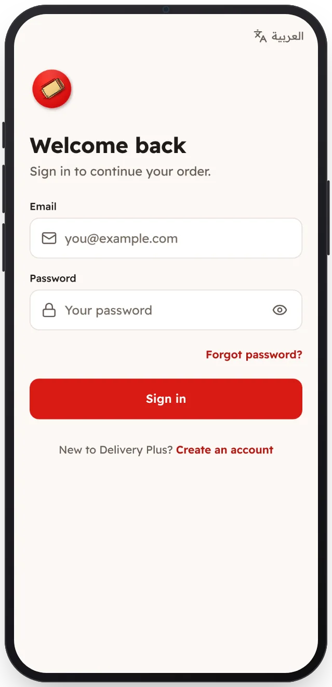

<!-- Generated from the app's web build (screens in docs/screens); regenerate rather than edit by hand. -->
[Customer app](../../../README.md) › [Screens](../README.md) › 2 of 13 · [العربية](../ar/02-sign-in.md)

<h1 align="center">Sign in</h1>

Email and password; the session stays signed in.

<a href="01-welcome.md">← Previous</a> &nbsp;·&nbsp; <b>2 / 13</b> &nbsp;·&nbsp; <a href="03-delivery-location.md">Next →</a>

