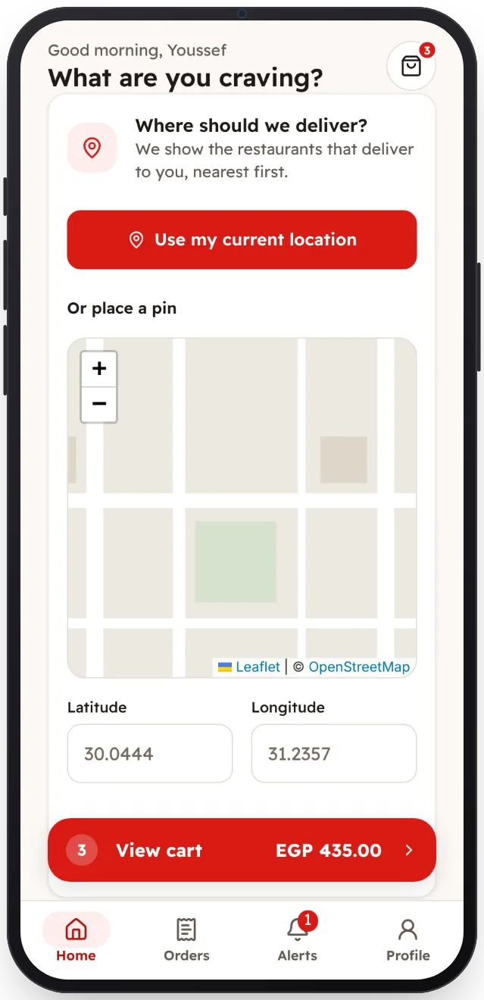

<!-- Generated from the app's web build (screens in docs/screens); regenerate rather than edit by hand. -->
[Customer app](../../../README.md) › [Screens](../README.md) › 3 of 13 · [العربية](../ar/03-delivery-location.md)

<h1 align="center">Where should we deliver?</h1>

The current location or a pin on the map decides which restaurants appear.

<a href="02-sign-in.md">← Previous</a> &nbsp;·&nbsp; <b>3 / 13</b> &nbsp;·&nbsp; <a href="04-home.md">Next →</a>

