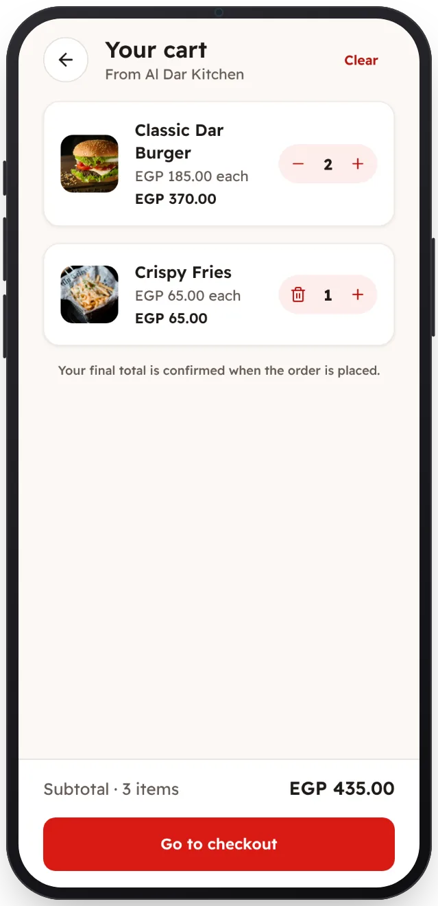

<!-- Generated from the app's web build (screens in docs/screens); regenerate rather than edit by hand. -->
[Customer app](../../../README.md) › [Screens](../README.md) › 6 of 13 · [العربية](../ar/06-cart.md)

<h1 align="center">Cart</h1>

Change quantities; the subtotal follows.

<a href="05-restaurant.md">← Previous</a> &nbsp;·&nbsp; <b>6 / 13</b> &nbsp;·&nbsp; <a href="07-checkout.md">Next →</a>

