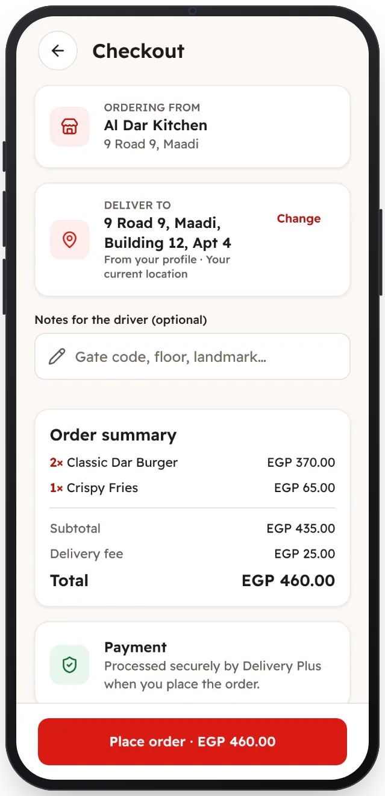

<!-- Generated from the app's web build (screens in docs/screens); regenerate rather than edit by hand. -->
[Customer app](../../../README.md) › [Screens](../README.md) › 7 of 13 · [العربية](../ar/07-checkout.md)

<h1 align="center">Checkout</h1>

Delivery address and location, notes, and the total with the delivery fee from the backend.

<a href="06-cart.md">← Previous</a> &nbsp;·&nbsp; <b>7 / 13</b> &nbsp;·&nbsp; <a href="08-order-preparing.md">Next →</a>

