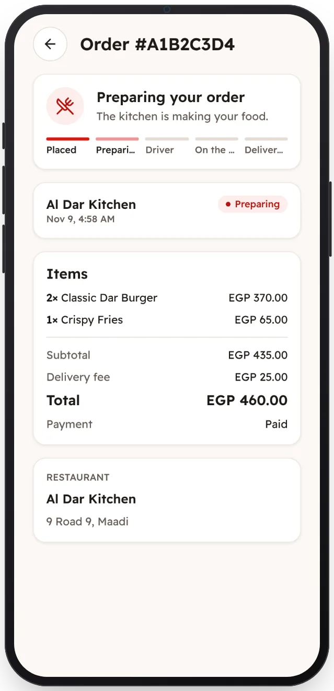

<!-- Generated from the app's web build (screens in docs/screens); regenerate rather than edit by hand. -->
[Customer app](../../../README.md) › [Screens](../README.md) › 8 of 13 · [العربية](../ar/08-order-preparing.md)

<h1 align="center">Order: preparing</h1>

Each step of the order, live, as the restaurant works on it.

<a href="07-checkout.md">← Previous</a> &nbsp;·&nbsp; <b>8 / 13</b> &nbsp;·&nbsp; <a href="09-order-on-the-way.md">Next →</a>

