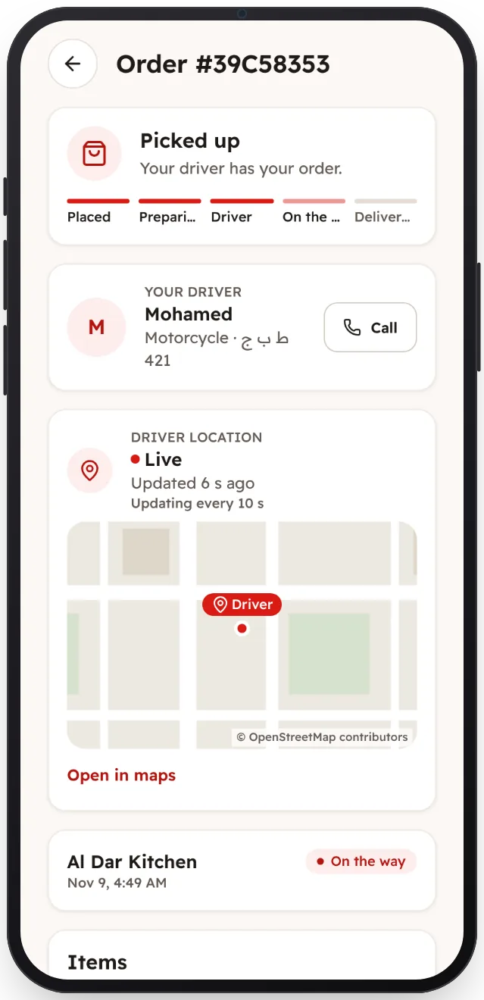

<!-- Generated from the app's web build (screens in docs/screens); regenerate rather than edit by hand. -->
[Customer app](../../../README.md) › [Screens](../README.md) › 9 of 13 · [العربية](../ar/09-order-on-the-way.md)

<h1 align="center">On the way</h1>

The driver's live position on the map, and a button to call them.

<a href="08-order-preparing.md">← Previous</a> &nbsp;·&nbsp; <b>9 / 13</b> &nbsp;·&nbsp; <a href="10-order-delivered.md">Next →</a>

