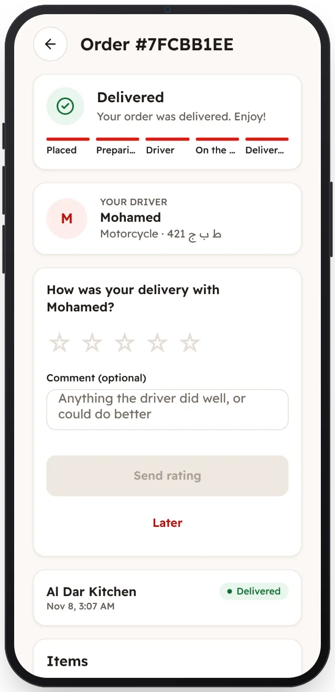

<!-- Generated from the app's web build (screens in docs/screens); regenerate rather than edit by hand. -->
[Customer app](../../../README.md) › [Screens](../README.md) › 10 of 13 · [العربية](../ar/10-order-delivered.md)

<h1 align="center">Delivered</h1>

The receipt, and a rating for the driver.

<a href="09-order-on-the-way.md">← Previous</a> &nbsp;·&nbsp; <b>10 / 13</b> &nbsp;·&nbsp; <a href="11-orders.md">Next →</a>

