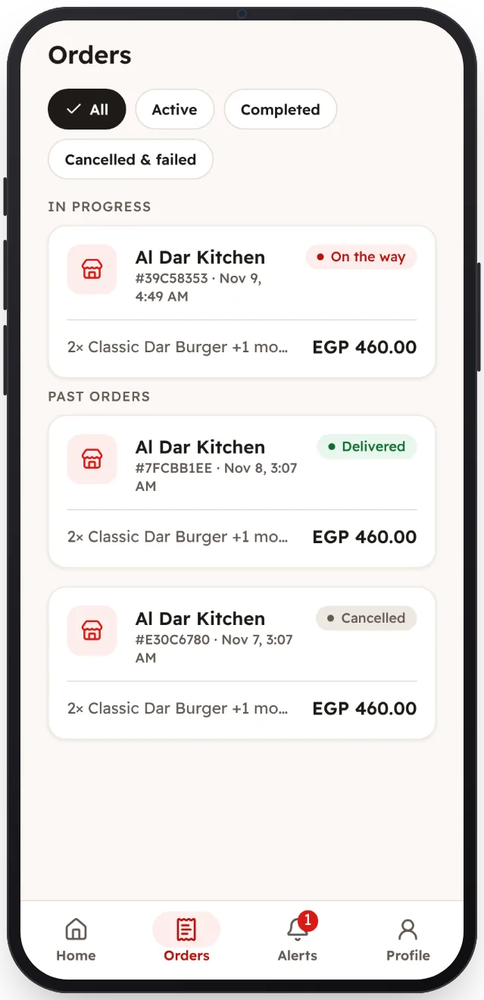

<!-- Generated from the app's web build (screens in docs/screens); regenerate rather than edit by hand. -->
[Customer app](../../../README.md) › [Screens](../README.md) › 11 of 13 · [العربية](../ar/11-orders.md)

<h1 align="center">Orders</h1>

Active and past orders, with cancellations and refunds explained.

<a href="10-order-delivered.md">← Previous</a> &nbsp;·&nbsp; <b>11 / 13</b> &nbsp;·&nbsp; <a href="12-notifications.md">Next →</a>

