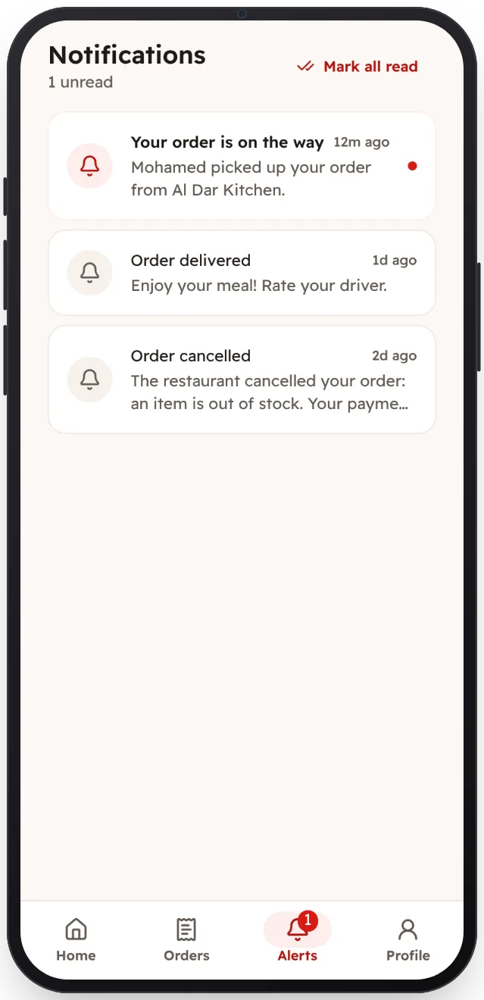

<!-- Generated from the app's web build (screens in docs/screens); regenerate rather than edit by hand. -->
[Customer app](../../../README.md) › [Screens](../README.md) › 12 of 13 · [العربية](../ar/12-notifications.md)

<h1 align="center">Notifications</h1>

Every status change of an order.

<a href="11-orders.md">← Previous</a> &nbsp;·&nbsp; <b>12 / 13</b> &nbsp;·&nbsp; <a href="13-profile.md">Next →</a>

