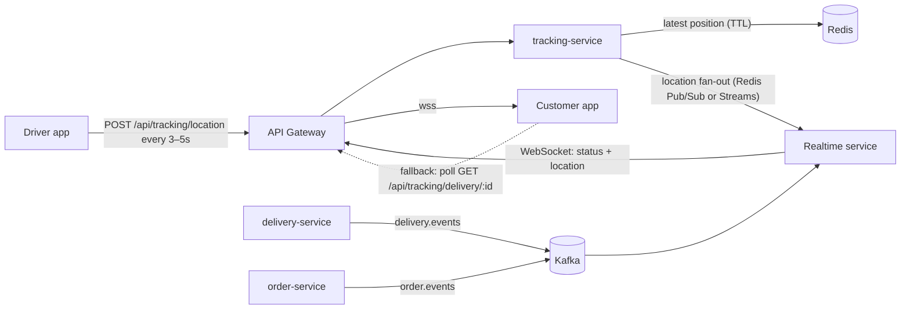

# Delivery Plus — Customer App Planning

_Last updated: 2026-09-30_

This plan covers the customer mobile app (`delivery-plus-customer-app`) and the backend work it depends on (`delivery-plus`). It records where the app was, where it is now, and what comes next: real-time tracking, Kafka reliability, notifications, and product features.

Sources: the app code, the backend code, and the backend's own snapshot in `delivery-plus/.project-context/16-current-state.md` and `05-event-driven-design.md`. When this file and the code disagree, the code wins.

---

## 1. Summary

- **The customer journey works end to end** against the real Gateway: sign up → browse → cart → checkout → follow the order → notifications → profile. Nothing on screen is mocked any more.
- **The next big feature is real-time delivery tracking, and it is blocked on the backend.** The app cannot find the delivery for an order, and delivery-service never publishes its Kafka events.
- **Kafka is at-least-once with in-process safeguards only.** Deduplication is in memory, there is no dead-letter topic, and most event IDs are random. That must be hardened before more features depend on events.

Recommended order: **Phase 0 (fix blocking bugs) → Phase 1 (Kafka reliability) → Phase 2 (real-time tracking) → Phase 3 (notifications and push) → Phase 4 (product features)**, with Phase 5 (quality/platform) running alongside.

---

## 2. Status comparison — before vs. now

"Before" is the app as it was at the start of the 2026-09-30 work session. "Now" is the current state.

| Area | Before | Now |
| --- | --- | --- |
| **Navigation** | Stack only. Home had four small text links (Orders / Alerts / Profile / Cart). No back buttons. | Bottom tabs (Home, Orders, Alerts, Profile) with an unread badge. Headers with back buttons. Stack screens for restaurant, cart, checkout, and order detail. |
| **Layout** | No safe-area handling; content ran under the notch and status bar. | Every screen uses a shared `Screen` with safe areas. CTAs are pinned in footers. |
| **Design system** | A few brand colors and hardcoded hex values per screen. 32px titles on every screen. | Semantic tokens (color, spacing, radius, elevation, icon size, touch targets), a type scale, and shared components (button, card, badge, skeleton, empty/error state, stepper, inline alert, icon). Colors recorded in `BRANDING.md`. |
| **Dark mode** | Bug: on a dark-mode phone text turned white on the light backgrounds. | Light-only by design (no dark wordmark exists yet), and consistent everywhere. |
| **Accessibility** | Few labels. Brand red used for small text (4.0:1 contrast). | Labels, roles and states on controls. Red text uses `#D70000` (5.4:1). 44pt touch targets. Reduced-motion respected. |
| **Data loading** | Each screen refetched on mount behind a full-screen spinner. No shared state. | Shared stale-while-revalidate cache with request de-duplication, refresh on focus, pull-to-refresh, skeletons, and a cache wipe when the user signs out or changes. |
| **Networking** | No timeout. Validation errors discarded. A wrong-password login cleared the session. | 15s timeout, typed offline errors, NestJS validation messages shown, session cleared only on authenticated 401s. |
| **Auth screens** | "Required" errors shown before typing. No autofill. | Errors shown after blur or submit, autofill hints, keyboard "next" chaining. |
| **Restaurants** | Horizontal list; loaded the first restaurant's menu on Home. No images. | Virtualized list with search (debounced, server-side), an "Open now" filter, cover and logo images, and status badges. |
| **Menu** | Flat list with an "Add" button. | Grouped by category, sold-out state, item images, in-place quantity steppers, and a "start a new cart?" prompt when adding from another restaurant (backend returns 409). |
| **Cart** | Fake $4.99 delivery fee that checkout left out. | Server-computed total, optimistic quantity changes with rollback, clear-cart confirmation, floating "View cart" bar. |
| **Checkout** | Worked (idempotency keys). | Same safe idempotency, plus a restaurant summary and a cart refresh and order cache update after success. |
| **Orders** | Showed raw restaurant UUIDs. | Split into "In progress" / "Past orders" with restaurant names and item summaries. |
| **Order detail** | Status text only. | Status timeline, refresh every 10s while active and on screen, customer cancellation (before preparing). |
| **Notifications** | **Three hardcoded fake alerts.** | Real API: unread styling, tap to mark read, mark all read, infinite scroll, tab badge. |
| **Profile** | Email-derived name and **fake** "Saved addresses / Payment methods" rows. | Real `GET/PATCH /api/users/me`: name, phone, address, avatar. Inline edit. Sign-out confirmation. |
| **Splash** | Held but never hidden; a second hand-made logo screen was shown instead. | Native splash stays up until the session loads, then hides. |
| **Tests** | 12 unit tests. | 31 unit tests (API errors, route mappings, cache, cart optimism/rollback, formatting, menu grouping). Typecheck, lint (0 warnings), and web export all pass. |
| **Test data** | Empty dev database; the base seed made 1 restaurant, 1 item, 1 order. | `npm run seed:demo`: 6 restaurants (open/busy/closed), 29 dishes, images, a demo customer with profile, cart, notifications, and orders in every state. |
| **Docs** | Listed routes that don't exist (e.g. `GET /notifications/:id`). | `.project-context` corrected against the real controllers. |

### Still not done in the app

| Item | Why |
| --- | --- |
| Delivery / driver tracking panel | Blocked — no public order→delivery lookup (see §4). |
| Avatar upload from the app | The backend supports it (presigned POST); UI not built yet. |
| Push notifications | Not built in the backend or the app. |
| Dark mode | Needs a light version of the wordmark first. |
| Brand-red button contrast | White on `#FF0000` is 4.0:1, just below AA for 16px text. Kept on purpose to match the brand; revisit (§8). |
| Version control | The app folder is not a git repository. |

---

## 3. Backend capabilities the app depends on

| Capability | Backend today | App today |
| --- | --- | --- |
| Auth, JWT, roles | Implemented (plus email verification, which is off by default, and lockout) | Used |
| Restaurants, menus, search | Implemented | Used |
| Cart (Redis) | Implemented | Used, with optimistic updates |
| Orders + state machine | Implemented, with idempotent creation | Used; customer cancel supported |
| Payments | Simulated only; failed payments have a race bug (§4) | Used |
| Delivery + driver lifecycle | Implemented over HTTP | **Not reachable** by customers |
| Tracking | Last known location only, in Redis with a 300s TTL; no history, no push | **Not reachable** |
| Notifications | Only `ORDER_CONFIRMED` is created; other handlers do nothing | Used (list/read) |
| Media uploads | Presigned S3 POST for avatars, restaurants, items | Displays images; no uploads yet |
| Kafka reliability | In-memory dedup, no DLQ, delivery events never published | n/a |
| Real-time push (WebSocket/SSE) | **None** — the Gateway only proxies HTTP | Polls instead |

---

## 4. Known bugs and gaps (blocking or risky)

| # | Issue | Impact | Where | Severity |
| --- | --- | --- | --- | --- |
| B1 | **Failed payment returns 500.** The `payment.failed` consumer in order-service sets `CANCELLED`, then payment-service's own HTTP sync to `FAILED` gets a 409. | Customer sees "having trouble" instead of "payment failed"; the order shows as Cancelled. | payment-service / order-service | High |
| B2 | **No order→delivery lookup.** `Order` has no `deliveryId` and there is no `GET /deliveries/by-order/:orderId`. | Blocks all tracking UI. | delivery-service | High |
| B3 | **Delivery Kafka events never published.** The publisher exists but lifecycle methods never call it. | No event-driven tracking, notifications, or analytics for deliveries. | delivery-service | High |
| B4 | **Only "Order Confirmed" notifications exist.** Payment and driver-assigned handlers are empty; picked-up and delivered are not consumed. The payload lacks `customerId`. | The Alerts tab never shows delivery progress. | notification-service + event payloads | Medium |
| S1 | `GET /deliveries/:id` has no ownership check. | Any signed-in user can read any delivery. | delivery-service | High (security) |
| S2 | `GET /tracking/driver/:userId` has **no auth guard at all**. | Anyone can read any driver's last location. | tracking-service | High (security) |
| S3 | `PATCH /notifications/:id/read` doesn't check the owner. | A user can mark another user's notifications as read. | notification-service | Low |
| K1 | Kafka dedup is an in-memory `Set`; exhausted messages are logged and committed (no DLQ); order and delivery events use random `uuidv4()` IDs. | Duplicates after restarts or rebalances; lost messages on failure. | shared `KafkaConsumerService` | Medium |
| E1 | Email verification tokens are never emailed. Turning on `EMAIL_VERIFICATION_REQUIRED` would lock out every new user. | Feature can't be enabled. | auth-service | Low (off by default) |

---

## 5. Roadmap

### Phase 0 — Fix blocking bugs (backend, ~1 sprint)

| Item | Approach |
| --- | --- |
| B1 failed-payment race | Pick one terminal status (`FAILED` fits the shared state machine) and one writer. Either the consumer sets `FAILED`, or payment-service's HTTP sync is the only writer and the consumer is removed. Update `scripts/seed-demo.ts`, which currently tolerates the 500. |
| B2 order→delivery lookup | Add `GET /deliveries/by-order/:orderId` with customer ownership check (via order-service), or add `deliveryId` to the order payload. |
| S1–S3 | Add ownership checks / `JwtAuthGuard`. Customers may only read their own order's delivery and tracking. |

**App follow-up:** add `services/deliveries.ts` + `services/tracking.ts`, and a delivery card on order detail (driver assigned, picked up, in transit) using polling.

### Phase 1 — Kafka reliability (backend)

This follows the backend's own "Kafka reliability track", extended.

1. **Wire `DurableEventIdempotencyService` into `KafkaConsumerService`** (already built in `shared`, unused). Add Redis to driver-service and notification-service, and give Redis a persistence volume in Compose so `processed` markers survive restarts.
2. **Dead-letter topics:** `<topic>.dlq` with the original payload, error, attempt count and consumer group. Add a small replay script.
3. **Publish delivery lifecycle events** (fixes B3): `delivery.driver_assigned`, `picked_up`, `in_transit`, `delivered`, `cancelled`.
4. **Deterministic event IDs everywhere:** UUID v5 of `<aggregateId>:<eventType>`, as payment-service already does, so duplicates can be deduplicated.
5. **Transactional outbox** for order-service and delivery-service: write the event row in the same DB transaction as the state change; a relay publishes it. This removes the "state changed but event lost" window.
6. **Partition keys:** key every event by `orderId` so each order's events stay in order.
7. **Versioned event contracts:** add `version` to envelopes, validate at runtime (e.g. zod or class-validator), and keep contracts in `shared/src/events`. Consider a schema registry later.
8. **Richer payloads:** include `customerId` (and `restaurantId`) in payment and delivery events so consumers don't need extra HTTP lookups (unblocks B4).
9. **Production topology:** 3 brokers, replication factor 3, `min.insync.replicas=2`; KRaft instead of ZooKeeper when upgrading Confluent images; consumer-lag monitoring (Kafka UI is already in dev).

### Phase 2 — Real-time delivery tracking

**Goal:** the customer watches the driver move on a map, with live status changes and an ETA, without refreshing.

**Prerequisites:** Phase 0 (B2, S1, S2) and Phase 1 step 3 (delivery events).

#### Architecture

#### Key decisions

| Decision | Recommendation | Why |
| --- | --- | --- |
| Transport to the app | **WebSocket** | React Native has a built-in `WebSocket` but no `EventSource`, so Server-Sent Events (SSE) would need a polyfill. WebSockets also let the app subscribe and unsubscribe per delivery. |
| Where connections live | A new **realtime service** (or a NestJS gateway in tracking-service), proxied by the Gateway with WebSocket upgrades enabled (`ws: true` in `http-proxy-middleware`) | Keeps connection state out of domain services. Scales separately. |
| High-frequency locations | **Redis Pub/Sub or Streams**, not Kafka | Locations are frequent, short-lived, and fine to drop; Kafka is best kept for lifecycle facts. |
| Lifecycle status changes | **Kafka** (`delivery.events`, `order.events`) | Durable, replayable, and already the integration backbone. |
| Auth | JWT on connect. Server checks the customer owns the order before subscribing to `delivery:<id>`. | Fixes the S1/S2 class of problems for the new channel. |
| History and ETA | Store a short trail per delivery (Redis list or Postgres) and compute a straight-line ETA first. Add a routing provider later. | Enables "driver is 5 min away" and a drawn route. |
| Fallback | Keep polling (already built) when the socket is down | Mobile networks drop connections. |

#### App work

- A `useDeliveryTracking(orderId)` hook: connect, subscribe, reconnect with backoff, fall back to polling, and pause when the screen is out of focus or the app is in the background.
- A map panel on order detail. The map library is still to be chosen: evaluate `expo-maps` against `react-native-maps` for Expo SDK 57 and check the versioned Expo docs before adding either.
- Driver card (name, vehicle), ETA, and a live status timeline.
- Battery and data limits: throttle re-renders to about 1 per second and animate marker moves.

#### Driver side (separate app)

Background location permission, and location sent every 3–5s only while a delivery is `PICKED_UP`/`IN_TRANSIT`. Out of scope for the customer app, but required for tracking to be meaningful.

### Phase 3 — Notifications

1. Implement the empty handlers in notification-service (payment completed, driver assigned, picked up, delivered, payment failed). Depends on Phase 1 step 8.
2. **Push notifications:** a device-token endpoint (e.g. `POST /api/notifications/devices`), a sender in notification-service, and `expo-notifications` in the app. Check SDK 57 docs; this needs a development build, not Expo Go.
3. Deep links from a notification to its order (`customermobile://order/<id>`; the `scheme` is already set in `app.json`).
4. An unread-count endpoint instead of counting the loaded pages.
5. Live in-app updates over the Phase 2 WebSocket channel.
6. Fix S3 (ownership on mark read).

### Phase 4 — Product features

| Feature | Backend needed | App |
| --- | --- | --- |
| Avatar upload | Already exists | Image picker + presigned POST + confirm |
| Reorder ("order again") | None (add items from a past order to the cart) | Button on past orders |
| Multiple saved addresses | Address book in user-service (today there's one `address` field) | Address picker at checkout |
| Delivery fee, tax, ETA per restaurant | Pricing fields in restaurant/order services | Show on cards and at checkout |
| Cuisine tags / categories on Home | Tags on restaurants + filter param | Category chips |
| Ratings and reviews | New reviews module/service | Rate after `DELIVERED` |
| Promotions / coupons | Promo service + order pricing | Promo field at checkout |
| Real payment provider | Replace the simulation (e.g. Stripe) with webhooks | Payment sheet, saved cards |
| Scheduled orders | Order `scheduledFor` field | Time picker |
| Localization (incl. Arabic, right-to-left) | Localized content optional | i18n strings, RTL layout checks |
| Dark mode | Light wordmark asset | `Colors.dark` palette (tokens already semantic) |

### Phase 5 — Quality and platform (ongoing)

| Item | Detail |
| --- | --- |
| **Put the app under git** | Highest-value quick fix; there's no history today. |
| App CI | Typecheck, lint, vitest, `expo export` on every PR. |
| UI end-to-end tests | Maestro or Detox flows run against the `seed:demo` data: login → order → cancel. |
| Environment config | Per-platform `EXPO_PUBLIC_API_BASE_URL`. Media URLs must be reachable from emulators (Android can't reach `localhost:9000`). |
| EAS builds | Development build (needed for push and maps), preview and production profiles. |
| Observability | Correlation IDs are already in errors: show them in the app's error details, add Sentry (app) and OpenTelemetry + metrics (backend). |
| Performance budget | Track startup time and list frame drops. Add `FlashList` only if profiling shows a need. |
| Accessibility audit | Screen-reader pass on every screen; decide on button contrast. |

---

## 6. Prioritized backlog

Effort: S ≈ ≤1 day, M ≈ 2–5 days, L ≈ 1–2 weeks.

| ID | Item | Area | Depends on | Effort | Priority |
| --- | --- | --- | --- | --- | --- |
| P0-1 | Put customer app under git + CI | App | — | S | P0 |
| P0-2 | Fix failed-payment race (B1) | Backend | — | S | P0 |
| P0-3 | Ownership/auth on deliveries & tracking (S1, S2) | Backend | — | S | P0 |
| P0-4 | Order→delivery lookup (B2) | Backend | P0-3 | S | P0 |
| P1-1 | Publish delivery events (B3) | Backend | — | M | P1 |
| P1-2 | Durable idempotency in consumer + Redis persistence | Backend | — | M | P1 |
| P1-3 | Dead-letter topics + replay script | Backend | P1-2 | M | P1 |
| P1-4 | `customerId` in event payloads + notification handlers (B4) | Backend | P1-1 | M | P1 |
| P1-5 | Delivery card on order detail (polling) | App | P0-4 | S | P1 |
| P2-1 | Realtime service + gateway WebSocket proxy | Backend | P0-3, P1-1 | L | P2 |
| P2-2 | Location fan-out (Redis Pub/Sub or Streams) + trail + ETA | Backend | P2-1 | M | P2 |
| P2-3 | Live map tracking screen | App | P2-1, P2-2 | L | P2 |
| P2-4 | Deterministic event IDs + outbox for order/delivery | Backend | P1-1 | L | P2 |
| P3-1 | Push notifications (device tokens + expo-notifications) | Both | P1-4 | L | P3 |
| P3-2 | Avatar upload in the app | App | — | S | P3 |
| P3-3 | Reorder | App | — | S | P3 |
| P4-x | Addresses, fees/ETA, reviews, promos, real payments, i18n | Both | varies | L each | P4 |

---

## 7. Milestones

| Milestone | Includes | Customer-visible result |
| --- | --- | --- |
| **M1 — Stable core** | P0-1 to P0-4 | Failed payments show a clear message; tracking data is private |
| **M2 — Reliable events** | P1-1 to P1-5 | Delivery progress in the Alerts tab and on order detail |
| **M3 — Live tracking** | P2-1 to P2-4 | Live driver on a map with ETA |
| **M4 — Engagement** | P3-x | Push alerts, avatar, reorder |
| **M5 — Growth features** | P4-x | Addresses, promos, reviews, real payments |

---

## 8. Risks and open decisions

| Topic | Question / risk | Suggested default |
| --- | --- | --- |
| Failed-payment terminal status | `FAILED` or `CANCELLED`? | `FAILED` (matches the shared state machine and payment-service intent) |
| Realtime placement | New service or inside tracking-service? | New small service; cleaner scaling |
| Kafka for locations | Could overload topics and consumers | Keep locations on Redis; Kafka for lifecycle only |
| Cancellation window | Backend allows cancel until pickup; the app offers it until preparing | Keep the app stricter, and make it a backend rule later |
| Brand button contrast | 4.0:1 is below AA for normal text | Decide with design: darker fill (`#D90000`) or larger/bolder label |
| Maps dependency | Native module → needs a development build | Adopt together with push (also needs a dev build) |
| Demo data | `seed:demo` relies on today's flows (e.g. tolerates B1) | Update the seed with each backend fix |

---

## 9. References

- App context: `.project-context/` (API contract, roadmap), `.github/skills/react-native-design-system/BRANDING.md`
- Backend: `delivery-plus/.project-context/16-current-state.md`, `05-event-driven-design.md`, `13-known-issues-and-gotchas.md`
- Demo data: `delivery-plus/scripts/seed-demo.ts` (`npm run seed:demo`)
