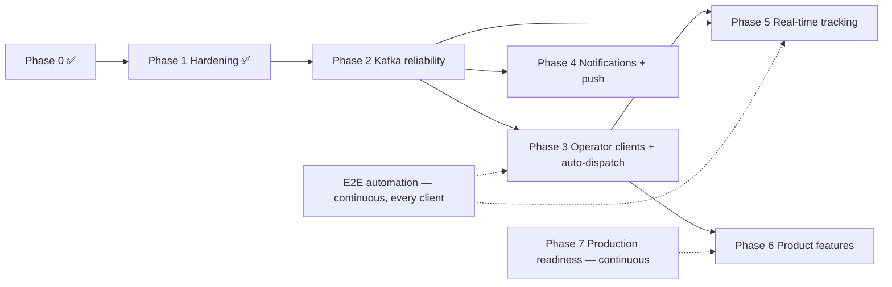

# Delivery Plus — Platform & Customer App Planning

_Last updated: 2026-09-30, after the hardening phase and the E2E automation foundation._

This plan covers the customer app (`delivery-plus-customer-app`) and the backend (`delivery-plus`). It is rebuilt from the code and from what the automated runs actually showed. **Definition of done:** a change is done only when the right levels of verification pass: unit → integration (live API) → contract (OpenAPI) → UI/E2E → business flow. Each "done" below names the levels it has.

---

## 1. Summary

- **Hardening is done and verified.**
  - Delivery dispatch is restricted to the order's restaurant owner (or admin).
  - Driver profiles are no longer public.
  - Notification mark-read is owner-scoped.
  - The cart rate limit is actually enforced.
  - Customers can no longer refund their own payments.
- **UI automation exists and runs:** Maestro drives the real customer app (web build, headless Chromium) against an isolated, deterministically seeded backend. **9/9 flows pass from a fresh environment**, including a full order → restaurant → dispatch → driver → delivered → notification cycle.
- **E2E found five real bugs that no other layer caught:**
  1. The order detail screen crashed on web (React Compiler + a `!` assertion).
  2. The delivery card never left its loading state.
  3. Duplicate "Order Confirmed" notifications (racing status writers).
  4. A fresh Kafka crashed driver-service on boot.
  5. 10% of UI checkouts would be randomly declined.

  All are fixed and covered by tests.
- **The main blocker is unchanged: only the customer app exists.** The restaurant and driver steps in the business flow are API stand-ins, and nothing dispatches deliveries automatically.
- **Kafka review:** events are keyed by a random `correlationId`, so there is no per-order ordering beyond today's single-partition topics. Delivery events are still never published, and there's no durable dedup, DLQ, or outbox. This has to be fixed before real-time tracking.

---

## 2. Completed (verified)

| Item | What changed | Verified by |
| --- | --- | --- |
| **P0-1** App git + CI | Repo on `main`; CI runs typecheck, lint (0 warnings), vitest, web export | Fresh-clone run of all CI steps. Not yet run on GitHub (no remote) |
| **P0-2** Failed-payment race | One terminal state (`FAILED`); tolerant payment-event consumer; typed 409 handling | Unit (order + payment); live API; DB state; **UI: declined order shows Failed** |
| **P0-3** Delivery/tracking reads | JWT → order ownership → delivery; driver location self/admin only | Unit; live API (24 checks); **UI: another customer's order is refused** |
| **P0-4** Order → delivery lookup | `GET /api/deliveries/by-order/:orderId` | Unit; live API; OpenAPI; **UI: "Finding a driver" and delivery stages** |
| **P0-5** Delivery card (polling) | Order detail shows delivery progress, 10s polling | **UI: waiting state and every stage in the business flow** |
| **H1** Dispatch ownership | Create/assign/cancel: admin, or the owner of the order's restaurant (checked by order-service with the owner's token) | Unit (allowed + forbidden); live API (6 checks) |
| **H2** Driver profiles | `GET /drivers/available`: JWT + ADMIN (services use system tokens); `GET /drivers/:id`: driver themself or admin. tracking-service gained a system-token minter | Unit + guard metadata; live API (7 checks, incl. tracking still resolving drivers) |
| **H3** Cart rate limit | `RateLimitGuard` reads the handler limit, then the controller limit (the cart's class-level 30/min was ignored) | Unit regression; live: first 429 at request 31 |
| **H4** Notification ownership | Mark-read scoped to the owner, 404 otherwise; UUID validation (was a 500) | Unit; live API (3 checks) |
| **Refund authorization** (audit) | Refunds are admin/support-only; customers could refund their own completed payment at any time, even after delivery | Unit; live API |
| **Order status compare-and-set** (E2E finding) | `UPDATE … WHERE status = expected`; only the winning writer publishes. Fixed duplicate `order.confirmed` → duplicate notifications | Unit (concurrent writers); live: fresh env shows 2 notifications, 0 duplicates |
| **Kafka topic bootstrap** (E2E finding) | Consumers create their topic before subscribing. A fresh cluster used to crash driver-service (`delivery.events` did not exist yet) | Unit; live: cold start, 0 restarts |
| **Order detail crash** (E2E finding) | React Compiler evaluated `order!.id` during render while the order was loading → blank page | UI (every order flow); code comment |
| **Delivery card stuck loading** (E2E finding) | `useResource` treated a loaded `null` ("no delivery yet") as missing | Unit regression; UI |
| **E2E environment** | `docker-compose.e2e.yml` (project `delivery-plus-e2e`, gateway :3100, storage :9100, own volumes, payments always succeed), `npm run e2e:env:up/down/reset` | Cold start from empty volumes; seed; full UI run |
| **Deterministic seed** | `npm run seed:e2e`: 4 QA accounts, QA Kitchen / QA Night Cafe, scenarios S1–S4, id manifest; refuses non-localhost targets | Fresh env, 3 runs |
| **Maestro suites + runner + CI** | 9 flows, runner with control server, PR smoke / nightly full workflow | Local from-scratch run 9/9. GitHub run pending (§4) |
| **Shared seed helpers** | `scripts/lib/gateway-seed.ts` used by `seed-demo` and `seed-e2e` | Both seeds run live (typecheck + execution) |

---

## 3. Clients and what they use (verified in the repositories)

| Client | Exists | Services used | Complete workflows | Missing |
| --- | --- | --- | --- | --- |
| **Customer app** (Expo 57; web build under E2E) | ✅ | auth, users, restaurants, menus, cart, orders, payments, deliveries, notifications | sign in, browse/search, cart, checkout, order status + delivery polling, cancel, notifications, profile | avatar upload UI, push, live map, native (Android/iOS) E2E |
| **Restaurant dashboard** | ❌ | — | — | whole client. Contract exists: owner order list, status transitions, dispatch, menu/images |
| **Driver app** | ❌ | — | — | whole client. **Missing contract: "my current delivery"** (drivers cannot discover their assignment) |
| **Admin / ops** | ❌ | Swagger, Kafka UI (dev) | — | whole client |

---

## 4. Current blockers (real, verified)

| # | Blocker | Blocks | Owner |
| --- | --- | --- | --- |
| B1 | **No restaurant client** | Real kitchen workflow; restaurant UI E2E | New client |
| B2 | **No driver client**, and no "current delivery" endpoint | Real delivery workflow; driver UI E2E; real location data for tracking | New client + delivery-service |
| B3 | **No auto-dispatch** (delivery-service consumes no events) | Orders progressing without a person calling the API | delivery-service |
| B4 | **Delivery events never published** | Notifications beyond "confirmed"; auto-dispatch triggers; real-time tracking | delivery-service |
| B5 | **E2E CI cannot run yet:** the backend changes (E2E env, `seed:e2e`, hardening) are uncommitted, and the app repo has no remote | Automated E2E in CI | Commit/PR the backend changes; add the app remote |
| B6 | Android/iOS E2E not set up (needs a development build + emulator; no Android SDK on this machine) | Native UI regression coverage | Platform |

---

## 5. Current sprint (next)

1. **Land the work:** open a backend PR (hardening, CAS, Kafka topic bootstrap, E2E env, `seed:e2e`); push the app repo; run `e2e.yml` on GitHub and fix any Linux-only differences.
2. **Kafka reliability core** (unblocks B3/B4): publish delivery events; key every event by `orderId`; deterministic event ids for order/delivery; wire durable idempotency + Redis persistence; dead-letter topic.
3. **Dispatch + driver contracts:** auto-dispatch consumer (`order.ready_for_pickup` → create + assign); `GET /drivers/me/delivery`.
4. **Paid-then-cancelled compensation** (refund policy), now that refunds are admin-only.

---

## 6. Phase roadmap (recalculated)

| Phase | Status | Remaining work | Depends on | Customer-visible | Infra | Multi-client | Prod-blocking |
| --- | --- | --- | --- | --- | --- | --- | --- |
| 0 Foundation | ✅ | — | — | ✓ | | | |
| 1 Hardening | ✅ (H5 open) | Paid-then-cancelled refund policy; restaurant `ownerId` is public in restaurant payloads (low) | — | | ✓ | | ✓ |
| 2 Kafka reliability | Not started | Delivery events; `orderId` partition key; deterministic ids; durable dedup + Redis persistence; DLQ + replay; outbox for order/delivery; richer payloads (`customerId`) | — | | ✓ | | ✓ |
| 3 Operator clients | Not started | Auto-dispatch; `drivers/me/delivery`; **restaurant dashboard MVP**; **driver app MVP**; each with Maestro flows + CI from day one; replace the E2E stand-ins with real UI steps | 1, 2 | ✓ | ✓ | ✓ | ✓ |
| 4 Notifications + push | Not started | Handlers for payment/driver/pickup/delivered; device tokens; `expo-notifications` (dev build); deep links; unread-count endpoint | 2 | ✓ | ✓ | ✓ | |
| 5 Real-time tracking | Blocked | Location trail + ETA; Redis fan-out; realtime service + gateway WebSocket; swap `useOrderDelivery` from polling to socket; map | 2, 3 (driver app produces locations) | ✓ | ✓ | ✓ | |
| 6 Product features | Partly unblocked | Avatar upload UI and reorder (no backend work); addresses, fees/ETA, reviews, promos, real payments (with H5), i18n/RTL, dark mode | varies | ✓ | | | |
| 7 Production readiness | Ongoing | §10 | — | | ✓ | | ✓ |

**Why tracking moved behind operator clients:** real-time tracking needs (a) published delivery events, (b) a driver client sending locations, and (c) auto-dispatch so there's something to track without a person driving the API. None of those exist yet.

---

## 7. E2E automation (permanent)

| Aspect | Current state |
| --- | --- |
| **Framework** | Maestro CLI 2.11 (web support is beta; Chromium). Chosen because it drives React Native on Android/iOS and web with one YAML syntax. No other E2E framework existed in either repo |
| **Supported clients** | Customer app, **web build**. Android/iOS: flows use platform-neutral `id:` selectors (`testID` + `nativeID`), but no emulator job yet (B6). Restaurant/driver: no clients |
| **Environment** | Compose project `delivery-plus-e2e` (base + test + e2e overlays): isolated DB/Redis/Kafka/object-storage volumes, gateway `:3100`, storage `:9100`, `PAYMENT_SUCCESS_RATE=1`. Runs next to the dev stack. `npm run e2e:env:reset` = down → up → seed |
| **Deterministic seed** | `npm run seed:e2e`: `qa.customer`, `qa.customer2`, `qa.restaurant`, `qa.driver` @`delivery-plus.test` (test-only password via `E2E_PASSWORD`, localhost-only guard); QA Kitchen (fixed prices; one sold-out item), QA Night Cafe (closed); scenarios S1 delivered, S2 payment declined, S3 ready without a delivery, S4 another customer's order; manifest of generated ids |
| **Smoke (PR)** | login → Home · search → restaurant → menu · add → quantity → total · cart → checkout → order |
| **Regression (nightly)** | waiting-for-driver state · declined → Failed · another customer's order refused · gateway outage → offline state → recovery with session intact |
| **Business (nightly)** | customer UI orders → restaurant prepare/ready → dispatch → driver pickup/start/complete → customer UI: Delivered + notification |
| **Runner** | `e2e/scripts/run.mjs`: builds web against the E2E gateway (`--clear`), serves it, hosts a control server for stand-ins/fault injection, clears rate-limit keys (E2E Redis only), runs flows asynchronously |
| **CI** | Customer app `ci.yml` (code checks, every push/PR) + `e2e.yml` (PR: smoke; nightly/manual: all). Starts the backend E2E stack from `BACKEND_REF`, seeds, runs headless |
| **Failure artifacts** | JUnit per flow, screenshots and debug output per flow (`e2e/.artifacts`), backend compose logs on failure. Uploaded 14 days |
| **Known limits** | Maestro web cannot scroll react-native-web lists (it scrolls the window; RN-Web keeps `body` overflow hidden), so headless runs use a 430×1600 viewport. Restaurant/driver steps are API stand-ins (labelled in the flow). Checkout decline can't be triggered from the UI (no payment input); covered via seeded S2 |
| **Runtime** | ~7.7 min for all 9 flows locally (login dominates) |

**Rule for new work:** every client gets `testID`s, a Maestro suite and CI from its first commit. Every critical business flow gets E2E coverage before it is called done.

---

## 8. Business-flow verification

| Flow | Automatically verified | How | Not verified |
| --- | --- | --- | --- |
| Customer order cycle (sign in → browse → cart → checkout → order) | ✅ | UI (smoke) | — |
| Restaurant prepares / ready | ⚠️ | API stand-in inside the business flow | No restaurant UI |
| Dispatch + driver assignment | ⚠️ | API stand-in (manual dispatch) | No auto-dispatch, no UI |
| Driver pickup / in transit / delivered | ⚠️ | API stand-in | No driver UI; no location streaming |
| Customer sees delivery progress + Delivered | ✅ | UI (business flow, via polling) | Real-time push |
| Notification after the order | ✅ | UI (Alerts shows "…has been confirmed") | Other notification types don't exist |
| Payment decline | ✅ | UI (seeded S2) + API | Declining from the UI |
| Authorization (other customer's order) | ✅ | UI + live API checks | — |
| Temporary outage | ✅ | UI with gateway stopped/started | Slow network / partial failures |
| Critical path via API only | ✅ | `npm run e2e` in backend CI | — |

### Flow reference (source → destination, protocol, owner, events, storage, auth)

| Flow | Path | Protocol | Data owner / storage | Events | Auth boundary |
| --- | --- | --- | --- | --- | --- |
| Order | App → Gateway → order-service (→ cart, restaurant) → payment-service → order (HTTP sync + `payment.*` consumer, compare-and-set) → notification-service | HTTP + Kafka | order/payment DBs, cart in Redis | `order.*`, `payment.*` | JWT; ownership in each service |
| Kitchen | (stand-in) owner → order-service | HTTP | order DB | `order.preparing`, `order.ready_for_pickup` (no consumers) | JWT owner + restaurant ownership |
| Delivery | owner → delivery-service (→ order-service with owner token; → driver-service with system token) → driver → delivery-service | HTTP | delivery + driver DBs | none published (B4) | Dispatch: admin or the order's restaurant owner; driver actions: assigned driver |
| Tracking | driver → tracking-service → Redis (last location, 300s TTL); customer → tracking-service → delivery-service (user token) | HTTP (no push) | Redis | — | Driver: own location; customer: via delivery ownership |
| Media / profile | App → user-service (presign) → S3 (direct POST to `pending/`) → user-service (confirm: byte check, content-addressed copy) → `avatarUrl` | HTTPS | S3 + user DB | — | JWT; key prefix bound to the requester |

---

## 9. Architecture reviews

### Kafka (verified in code)

| Area | Finding | Needed before real-time |
| --- | --- | --- |
| Delivery lifecycle events | `publishEvent` exists, never called; order/driver consumers of `delivery.*` never fire | ✅ publish |
| Durable idempotency | Built (`DurableEventIdempotencyService`), not wired; in-memory `Set` | ✅ wire + Redis persistence |
| DLQ / replay | None; exhausted messages logged and committed | ✅ |
| Event ids | Payment deterministic (UUID v5); order and delivery random `uuidv4()` | ✅ deterministic |
| Payloads | Order has `customerId`/`restaurantId`; payment and delivery don't | ✅ add |
| Partitioning / order | **Key = random per-event `correlationId`** → no per-order ordering; single-partition topics hide it | ✅ key by `orderId` |
| Outbox | None: order-service publishes after commit (lost on crash); payment re-publishes via status markers | ✅ for order/delivery |
| Topic provisioning | Fixed: consumers ensure topics (default 1 partition, broker defaults) | Explicit partitions/replication in prod |
| Double writers | HTTP sync + consumers for payment statuses; now safe (compare-and-set, tolerant consumer) | Keep until the outbox makes events authoritative |

### S3 / media (verified)

| Entity | Client | API (presign → confirm) | Storage → DB | Authorization | Verified live |
| --- | --- | --- | --- | --- | --- |
| Customer avatar | Customer app: **no upload UI** | `POST /users/me/avatar/image-upload-url` → `…/confirm` | `users/<id>/avatar/<sha256>` → `user_profiles.avatarUrl` | JWT; prefix bound to own id | ✅ (seed:demo) |
| Restaurant cover/logo | None (API/seed) | `POST /restaurants/:id/image-upload-url` → `…/image-confirm` | `restaurants/<id>/<type>/…` → `coverImageUrl`/`logoUrl` | RESTAURANT_OWNER + ownership on both steps | ✅ cover (seed:demo) |
| Menu item image | None | `POST /menus/menu-items/:id/image-upload-url` → `…/image-confirm` | `restaurants/<rid>/menu-items/<id>/…` → `imageUrl` | Owner + restaurant ownership on both steps | ⚠️ no seed exercises it |

Failure handling: presign policies enforce content type and size; confirm re-verifies the bytes; `pending/` expires after 1 day. **Gaps:** replaced images are never deleted; an object copied before a failed DB write is orphaned (documented); dev/E2E URLs are `localhost:9000`/`:9100`, which Android emulators and devices can't reach. No redesign needed.

---

## 10. Production readiness

| Area | Exists | Gap |
| --- | --- | --- |
| Deployment | Image builds + Trivy scans; prod compose overlay | No deploy pipeline, no staging |
| Rollback | — | No rollback procedure; migrations have no down-path policy |
| Staging | — | None (the E2E stack is the closest parity environment) |
| Observability | Structured logs, correlation-id middleware | No log aggregation; correlation ids not propagated across service HTTP calls or Kafka |
| Tracing / metrics | — | No OpenTelemetry, no metrics, no Kafka consumer-lag monitoring |
| Health | `/health`, `/health/live`, `/health/ready` per service | Gateway liveness only; no graceful shutdown hooks |
| Resilience | Kafka consumer retries (3×) | No HTTP timeouts, retries or circuit breakers between services |
| Backups / recovery | — | No Postgres backups, restore drill or DR plan; Redis without persistence |
| Secrets | `.env`, prod overlay requires secrets | No secrets manager or rotation |
| Security | CodeQL, `npm audit`, Trivy; authz hardening + tests | No DAST; no audit log; authz regression checks exist only as unit tests + local scripts |
| Rate limiting | Redis limiter on auth, orders, cart | No gateway-level limit |
| E2E in CI | Workflow written, local 9/9 | Blocked by B5 |
| Analytics | — | No event warehouse |

---

## 11. Future enhancements (product, beyond required work)

- **Customer:** saved addresses with a geocoded pin, reorder, favorites, ratings/reviews after delivery, coupons, scheduled orders, Arabic/RTL, dark mode (needs a light wordmark), richer tracking (ETA, driver card, route), saved payment methods, in-app support chat.
- **Driver:** background location, hand-off to a navigation app, proof of delivery (photo via the existing S3 flow), OTP confirmation at the door, shift and availability planning, earnings, offer/accept flow.
- **Restaurant:** kitchen display, prep-time estimates, opening hours (status is manual today), stock/out-of-stock scheduling (availability toggle exists), sales analytics, restaurant-funded promotions.
- **Platform:** geospatial search and delivery radius (PostGIS), fuzzy search, pricing engine and dynamic delivery fees, recommendations, fraud detection (payments, promo abuse), Kafka → warehouse analytics, feature flags, multi-region readiness.

---

## 12. Verification log (2026-09-30)

| Area | Command / check | Result |
| --- | --- | --- |
| Backend unit | `npm test` (13 workspaces) | 357 passed, 15 skipped (DB-integration suite) |
| Backend build / lint | `npm run build`, `npm run lint` | Pass; 0 errors in all workspaces |
| Contract | `npm run openapi:generate` + `openapi:validate` | 56 paths valid (drivers/refund auth updated) |
| Compose | `docker compose … config --quiet` (dev, test, e2e) | Valid |
| Live hardening | gateway checks against the dev stack | 18/18 (cart limit re-checked on a clean window: 429 at request 31) |
| E2E env | `npm run e2e:env:reset` from empty volumes | Healthy, 0 restarts; seed OK; 2 notifications, 0 duplicates |
| UI / E2E | `node e2e/scripts/run.mjs --suite all --build --headless` after reset | **9/9 passed**, 9 JUnit reports, 0 failures |
| App code checks | typecheck, lint, vitest | Pass; 40 unit tests |

---

## 13. Planning changes in this revision

- Added: hardening results, five E2E-found defects, the permanent **E2E automation** section, **business-flow verification**, Kafka and S3 reviews, **current blockers** and **current sprint**.
- Phase 1 (Hardening) marked done; Kafka reliability is now the next phase and a hard prerequisite for dispatch, notifications and tracking.
- Real-time tracking stays after operator clients: it needs a driver client and published delivery events.
- New rule: every client ships with `testID`s, a Maestro suite and CI; stand-ins in the business flow are replaced as the restaurant and driver clients land.
- Production readiness moved into its own tracked section, separate from product enhancements.
