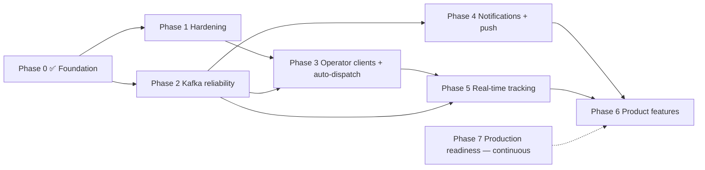

# Delivery Plus — Platform & Customer App Planning

_Last updated: 2026-09-30, after Phase 0._

This plan covers the customer app (`delivery-plus-customer-app`) and the backend it depends on (`delivery-plus`). It was rebuilt from the code, not from earlier plans. Where docs and code disagreed, the code won. Every "done" below was verified; §11 lists the checks.

---

## 1. Summary

- **Phase 0 is complete and verified.**
  - The customer app is under git with CI.
  - The failed-payment race is fixed.
  - Delivery and tracking reads are ownership-checked.
  - Customers can resolve an order's delivery.
  - Order detail shows delivery progress by polling.
- **The biggest remaining gap is the missing operator clients, not the customer app.** There is no restaurant dashboard, driver app, or admin UI. Nothing dispatches deliveries automatically. So a real customer order stops at `CONFIRMED` unless someone drives the rest through the API. Today only scripts do that.
- **Kafka is still "at-least-once with in-memory safeguards".** Delivery events are never published, and there's no DLQ, outbox, or durable dedup. Notifications and real-time tracking both depend on fixing this.
- **The review found five more authorization/correctness issues** (§6.1). They're small, and they block production.
- **Roadmap changes** (§8): a hardening phase first, then Kafka reliability, then **operator clients + auto-dispatch** (new), then notifications, then real-time tracking. Tracking moved later because it needs a driver client to produce locations. Product features and platform work follow.

---

## 2. Client ecosystem (verified)

Only **one client exists**: the customer app. The backend README says it is backend-only by design. Restaurant, driver, and admin workflows exist only as API routes, exercised today by `scripts/seed.ts`, `scripts/seed-demo.ts`, `scripts/e2e.ts`, and Swagger UI.

| Client | Exists? | Responsibilities | Services consumed | Workflows complete | Partial / missing | Kafka | Redis | S3 | Mocked |
| --- | --- | --- | --- | --- | --- | --- | --- | --- | --- |
| **Customer app** (Expo 57) | ✅ | Sign up/in, browse, cart, checkout, orders, delivery status, notifications, profile | auth, users, restaurants, menus, cart, orders, payments, deliveries, notifications | Auth, browse/search, cart, checkout (incl. declines), order history/detail/cancel, delivery status (polling), notifications list/read, profile edit | Avatar upload (backend ready, no UI); live map; push | Indirect (notifications and order status come from events) | Indirect (cart, rate limits) | Displays images; **no uploads** | Nothing |
| **Restaurant dashboard** | ❌ | Accept/prepare orders, mark ready, dispatch, menu and image management, open/close | restaurants, menus, orders, deliveries | — | Everything; API only | Would consume `order.*` | — | Restaurant and menu image uploads | — |
| **Driver app** | ❌ | Go online/offline, accept delivery, pickup/start/complete, stream location | drivers, deliveries, tracking | — | Everything; API only | — | Location in Redis | — | — |
| **Admin / ops** | ❌ | Force transitions, suspend restaurants/drivers, support | all (ADMIN role) | — | No UI; Swagger and Kafka UI (dev) only | — | — | — | — |

Missing backend contracts for those clients: an order feed for restaurants (listing exists: `GET /orders/restaurant/:id`, but no push), a driver "my current delivery" endpoint, auto-dispatch, and driver job offers/acceptance (assignment is automatic, with no accept/decline).

---

## 3. Current status — before vs. now

"Before" is the start of the 2026-09-30 work. "Now" is after the UI pass and Phase 0.

| Area | Before | Now |
| --- | --- | --- |
| Version control / CI | App not under git; no CI | Git repo (`main`, 3 commits). GitHub Actions: typecheck, lint (0 warnings), vitest, Expo web export. Verified on a fresh clone. |
| Navigation / layout | Stack only, text links, no safe areas | Tabs (Home, Orders, Alerts, Profile) plus stack screens, safe areas, back buttons |
| Design system | Ad-hoc hex values; dark-mode text bug | Semantic tokens, type scale, shared components, light-only by design (`BRANDING.md`) |
| Data layer | Refetch on every mount, spinners | Shared stale-while-revalidate cache, refresh on focus, pull-to-refresh, skeletons, cache wiped on account change |
| Networking | No timeout; validation errors lost | 15s timeout, offline errors, NestJS messages shown, session cleared only on authenticated 401 |
| Catalog | Horizontal list, no images | Server search, "Open now", images, grouped menus, sold-out items |
| Cart / checkout | Fake $4.99 fee | Server totals, optimistic steppers, restaurant-conflict prompt, idempotent checkout |
| Payment decline | **500 error; order ended `CANCELLED`** | **Clear "payment failed"; order ends `FAILED`** (P0-2) |
| Orders | Raw restaurant UUIDs | In progress / past sections, names, timeline, 10s polling, customer cancel |
| Delivery | Not reachable (no order→delivery lookup) | **Delivery card on order detail**: finding a driver → assigned → picked up → on the way → delivered/cancelled (P0-4) |
| Notifications / profile | Hardcoded mocks | Real API (read / read-all / infinite scroll); profile read and edit |
| Tests | 12 | 36 unit tests (app) |
| Demo data | Empty dev DB | `npm run seed:demo`: 6 restaurants, 29 dishes, images, and a customer with orders in every state, including a real `FAILED` |

Still not done in the app: avatar upload UI, push notifications, live map, dark mode (needs a light wordmark), accessibility decision on brand-red buttons (white on `#FF0000` is 4.0:1).

---

## 4. Phase 0 — completed

| ID | Item | What changed (code) | Verified by |
| --- | --- | --- | --- |
| P0-1 | Customer app git + CI | `git init` on `main`. `.gitignore` excludes env files, `dist/`, `.expo/`, generated stubs. `.gitattributes` keeps LF. `.env.example`. Scripts: `typecheck`, `lint` (`--max-warnings=0`), `test`, `export:web`. `.github/workflows/ci.yml` (Node 22). `src/types/expo.d.ts` makes a fresh clone typecheck (the Expo-generated `expo-env.d.ts` is git-ignored). | All 4 CI steps pass on a **fresh clone** (Node 20.20.2 locally; CI pins 22; RN supports both). Not yet run on GitHub — no remote configured. |
| P0-2 | Failed-payment race | **Root cause:** order-service's `payment.failed` consumer wrote `CANCELLED` while payment-service's HTTP sync wrote `FAILED`, so the second writer got a 409 and `/process` returned 500. **Fix:** one terminal state, `FAILED`, in both paths. Payment-service owns the transition; the Kafka consumer (`syncFromPaymentEvent`) is a convergence path that skips same-status, stale, and late events instead of failing. A decline after the customer already cancelled is treated as synced (order stays `CANCELLED`). A *completed* payment on a cancelled order still errors, because it needs a refund. The order client maps 409 → `ConflictError`. **Events:** added `order.payment_pending` and `order.failed`; these transitions were previously mislabeled `order.created`. | 7 new order-service tests and 6 new payment-service tests (success, decline, duplicate event, late event after cancel, stale event, unknown order, non-terminal conflict, completed-on-cancelled). Live: declined payment → HTTP 201, order `FAILED` in `order_service` DB, payment `FAILED` with both side effects marked done. Repeat process → idempotent. Cancel-then-decline → 201, order stays `CANCELLED`. |
| P0-3 | Delivery / tracking authorization | `GET /deliveries/:id` now follows the ownership chain JWT → order → delivery. Customers and restaurant owners are checked **by order-service using the requester's own token** (one source of truth for order access). Drivers must be the assigned driver. Admin can read anything. `GET /tracking/driver/:userId` was **fully public**; it now requires JWT with role DRIVER (own location only) or ADMIN. The tracking client maps 403 correctly (was 400). | Unit tests for every role and case, plus controller guard-metadata tests. Live (24 checks): 401 without token on all three routes; customer's own → 200; other customer → 403; restaurant owner of that order → 200; assigned driver → 200; unassigned driver → 403; customer reading a raw driver location → 403; driver's own → 200; other driver's → 403; customer tracking own delivery → 200 with location; other customer → 403. |
| P0-4 | Order → delivery lookup | New `GET /api/deliveries/by-order/:orderId` using the existing unique `deliveries.orderId` index. Order access is checked **before** the delivery lookup, so another customer's order never reveals whether a delivery exists. 404 "No delivery has been created for order … yet" vs 404 "Order … not found". Returns the same `Delivery` shape as `GET /:id` (`id, orderId, driverId, status, timestamps`). Public OpenAPI contract regenerated and validated. **Considered and rejected:** storing `deliveryId` on the order, which would need a cross-service write, a migration, and a new event for no benefit. | Unit tests (owner, not found, not owner, not yet created, driver). Live: owner → 200 `IN_TRANSIT`; other customer → 403; no delivery yet → 404; unknown order → 404. |
| P0-5 | Delivery card (polling) | `services/deliveries.ts`, `state/deliveries.ts` (`useOrderDelivery` hook, the seam for Phase 5 real-time), `components/delivery-card.tsx`, wired into order detail. Fetches only once the order can have a delivery (`READY_FOR_PICKUP` onward). Polls every 10s while active and focused; stops at `DELIVERED`/`CANCELLED`. Has skeleton, inline retry error, and accessibility labels. | 5 new app tests. Typecheck, lint, and web export pass. The data path was verified live through the gateway. **Not yet inspected visually on a device.** |

Also changed: `scripts/seed-demo.ts` no longer tolerates the old 500 and now seeds a real `FAILED` scenario. Backend docs and OpenAPI were updated.

---

## 5. Business flows

### 5.1 Customer order flow (as implemented)

| # | Step | Source → destination | Protocol | Data owner / storage | Events | Authorization boundary | Status |
| --- | --- | --- | --- | --- | --- | --- | --- |
| 1 | Register / login | App → Gateway → auth-service (→ user-service to create the profile) | HTTP; internal HMAC for auth→user | auth DB, user DB (Postgres) | — | Public, 5/min/IP rate limit | ✅ |
| 2 | Browse restaurants / menu | App → restaurant-, menu-service | HTTP | Postgres + Redis cache | — | Public reads | ✅ |
| 3 | Cart | App → cart-service (→ menu-service validates item) | HTTP | **Redis** | — | JWT (per-user cart) | ✅ (rate limit not enforced, §6.1) |
| 4 | Create order | App → order-service (→ cart, restaurant OPEN check); clears cart | HTTP + `Idempotency-Key` | order DB | `order.created` | JWT customer, 5/min/user | ✅ |
| 5 | Create payment | App → payment-service (→ order-service with the user's token) | HTTP | payment DB | `payment.created` → order `PAYMENT_PENDING` (HTTP sync + consumer) | JWT, owner of order | ✅ |
| 6 | Process payment | App → payment-service | HTTP | payment DB | `payment.completed`/`failed`; order `CONFIRMED`/`FAILED`; `order.confirmed` → notification | JWT, owner of payment | ✅ (fixed in P0-2) |
| 7 | Kitchen progression | **Restaurant owner** → order-service `PREPARING`, `READY_FOR_PICKUP` | HTTP | order DB | `order.preparing`, `order.ready_for_pickup` (**no consumers**) | JWT owner + restaurant ownership | ⚠️ API only, **no client** |
| 8 | Create delivery | **Owner/admin** → delivery-service | HTTP | delivery DB | none | Dispatch role (**no restaurant-ownership check**, §6.1) | ⚠️ Manual, **no auto-dispatch** |
| 9 | Assign driver | Owner/admin → delivery-service → driver-service (most recently updated AVAILABLE) → order `DRIVER_ASSIGNED` | HTTP (system token) | delivery + driver DBs | **delivery events not published** | Dispatch role | ⚠️ Manual |
| 10 | Pickup → in transit → delivered | **Driver** → delivery-service → order `PICKED_UP`/`DELIVERED`, driver AVAILABLE | HTTP | delivery, order, driver DBs | not published | Assigned driver | ⚠️ API only, **no client** |
| 11 | Customer delivery status | App → delivery-service `by-order` (→ order-service with the user's token) | HTTP polling (10s) | delivery DB | — | JWT → order → delivery | ✅ (P0-4/5) |
| 12 | Customer tracking | App → tracking-service → delivery-service (user token) + driver-service + Redis | HTTP | Redis (last location, 300s TTL) | — | JWT → delivery ownership | ✅ API (P0-3); **not used by the app yet** |
| 13 | Notifications | notification-service consumes `order.confirmed`; App lists/marks read | Kafka + HTTP | notification DB | Only `ORDER_CONFIRMED` created | JWT (mark-read has no owner check, §6.1) | ⚠️ Partial |

**Where the chain breaks:** steps 7–10 have no client and step 8 is not automated. In a real deployment an order stops at `CONFIRMED`; seed/e2e scripts only complete it by acting as owner and driver. Step 13 only ever produces "Order Confirmed".

### 5.2 Media / profile flow

| Step | Source → destination | Protocol | Storage | Authorization |
| --- | --- | --- | --- | --- |
| Request upload | App → user-service `POST /users/me/avatar/image-upload-url` | HTTP | — | JWT; key prefix bound to `users/<ownId>/avatar/` |
| Upload | App → S3-compatible store (presigned POST) | HTTPS direct | `pending/` (expires after 1 day) | Policy enforces content-type, size range, key |
| Confirm | App → user-service `…/avatar/confirm` | HTTP | Byte-verified, copied to a content-addressed key; `avatarUrl` saved in user DB | JWT; key must match the requester's prefix |
| Display | App → public object URL | HTTPS | Public read except `pending/` | None (public) |

Restaurant cover/logo and menu-item images use the **same** shared `S3StorageService`, with restaurant-ownership checks on both upload and confirm. **The app displays images but has no upload UI.** Gaps: replaced images are never deleted (orphans), and dev URLs are `localhost:9000`, which Android emulators and devices can't reach.

### 5.3 Delivery / tracking flow

| Step | Today | Target (Phase 5) |
| --- | --- | --- |
| Location source | Seed script posts `POST /tracking/location` (DRIVER role). **No driver client.** | Driver app sends every 3–5s while `PICKED_UP`/`IN_TRANSIT` |
| Storage | tracking-service → Redis, last location only, 300s TTL | + short trail per delivery, ETA |
| Fan-out | none | Redis Pub/Sub or Streams → realtime service |
| Status changes | HTTP only; `delivery.events` never published | `delivery.*` on Kafka → realtime service |
| Transport to app | App polls `by-order` every 10s | WebSocket through the gateway (`ws: true` not enabled today) |
| Authorization | JWT → order → delivery (P0-3) | Same check on socket subscribe |
| App seam | `useOrderDelivery` (polling) | Same hook backed by a socket; polling as fallback |

---

## 6. Open issues found in the Phase 0 review

### 6.1 Authorization / correctness (small, production-blocking)

| ID | Issue | Evidence | Fix |
| --- | --- | --- | --- |
| H1 | **Any restaurant owner can create/assign/cancel deliveries for any order** | `deliveries.service.ts` checks only that the role is in `DISPATCH_ROLES` | Check restaurant ownership of the order (via order-service with the requester's token, as P0-3 does) |
| H2 | **Driver profiles are public**: `GET /api/drivers/available` and `/api/drivers/:id` (userId, plate, status) | `public-openapi.ts` marks them `auth: false` | Internal-only for `available` (delivery-service uses it); JWT and admin/self for `:id` |
| H3 | **Cart rate limit never enforced** | `@RateLimit` is on the cart controller *class*, but `RateLimitGuard` reads handler metadata only | Use `getAllAndOverride([handler, class])` in the guard |
| H4 | Mark-notification-read has no ownership check | `markAsRead(id)` ignores the user | Scope the update by `userId` |
| H5 | A completed payment on an order the customer cancelled while paying | Now surfaces as a 409 (no longer hidden) | Automatic refund or a compensation flow |

### 6.2 Reliability / architecture

| ID | Issue | Evidence |
| --- | --- | --- |
| K1 | `delivery.events` never published | `publishEvent` exists; lifecycle methods don't call it. driver-service and order-service consumers for them never fire. |
| K2 | Consumer dedup is an in-memory `Set`; no DLQ; exhausted messages are committed | `KafkaConsumerService`; `DurableEventIdempotencyService` is built but unused |
| K3 | Order and delivery events use random `uuidv4()` IDs | Duplicates can't be deduplicated (payment events are deterministic) |
| K4 | No transactional outbox | order-service publishes after commit; a crash in between loses the event |
| K5 | Notification handlers for payment/delivery are empty; payloads lack `customerId` | `notifications.service.ts` |
| K6 | No auto-dispatch: delivery-service consumes no events | Deliveries only via manual API calls |
| O1 | No timeouts, retries, or circuit breakers on inter-service `fetch` | No `AbortSignal`/`signal` anywhere in service clients |
| O2 | Correlation IDs not propagated | Middleware exists; only auth→user forwards the header; Kafka events get fresh IDs |
| O3 | No graceful shutdown hooks | No `enableShutdownHooks` in any service |
| O4 | Redis has no persistence volume; single Kafka broker | Compose files |
| M1 | Replaced/orphaned media objects are never deleted | Only a `pending/` lifecycle rule |
| M2 | Dev media URLs unreachable from Android emulator/devices | `AWS_PUBLIC_BASE_URL=http://localhost:9000/...` |
| E1 | Email verification tokens are never emailed | auth-service; flag off by default |

---

## 7. Remaining work per phase (reviewed against the code)

The previous plan had Phases 1–5. Here is what changed:

| Previous phase | Verdict |
| --- | --- |
| Phase 1 — Kafka reliability | Still valid; **all steps still open**. Moved to Phase 2. "Publish delivery events" goes first, since it unblocks notifications and tracking. |
| Phase 2 — Real-time tracking | **Moved later (Phase 5).** Its prerequisites were only partly true: B2/S1/S2 are done, but it also needs a **driver client** to produce locations (missing from the old plan) and published delivery events. |
| Phase 3 — Notifications | Still valid (now Phase 4). Depends on Kafka payload changes (K5) and delivery events (K1). |
| Phase 4 — Product features | Split: app-only items (avatar upload, reorder) can be done any time; backend-dependent items stay later (now Phase 6). |
| Phase 5 — Quality / platform | **Partly done** (app git + CI). The rest is expanded into Phase 7 with the verified gaps from §9. |
| _(missing)_ | **Hardening** (§6.1), now Phase 1. |
| _(missing)_ | **Operator clients + auto-dispatch**, now Phase 3. Without them the business flow can't run outside scripts. |

---

## 8. Roadmap v2 (dependency-driven)

### Phase 1 — Hardening (backend, ~1 sprint)
H1–H4 from §6.1, plus H5 (refund/compensation decision). **Unlocks:** safe exposure of dispatch and driver APIs to real clients. Production-blocking.

### Phase 2 — Kafka reliability (backend, ~2 sprints)
1. **Publish delivery lifecycle events** (K1).
2. Wire `DurableEventIdempotencyService` into `KafkaConsumerService`; add Redis to driver-service and notification-service; give Redis a persistence volume (K2, O4).
3. Dead-letter topics plus a replay script (K2).
4. Deterministic event IDs for order and delivery events (K3).
5. Transactional outbox for order-service and delivery-service (K4).
6. Partition key = `orderId`; versioned event envelopes with runtime validation.
7. `customerId`/`restaurantId` in payment and delivery payloads (K5 prerequisite).

**Unlocks:** Phases 3–5. Infrastructure; not customer-visible.

### Phase 3 — Operator clients + auto-dispatch (new; multi-client)
- **Backend:** auto-dispatch (delivery-service consumes `order.ready_for_pickup`, creates the delivery, and assigns a driver) (K6). Driver "current job" endpoint. Optional offer/accept flow.
- **Restaurant dashboard MVP** (web): incoming orders, accept/prepare/ready, open/close, menu and availability, image uploads.
- **Driver app MVP** (Expo): online/offline, current delivery, pickup/start/complete, foreground location sending.
- Each client gets git + CI from day one (same template as P0-1).

**Unlocks:** a real end-to-end business flow without scripts; location data for Phase 5. Customer-visible (orders actually progress). Production-blocking.

### Phase 4 — Notifications + push
Implement the empty handlers (payment, driver assigned, picked up, delivered, payment failed) using the Phase 2 payloads. Add a device-token endpoint, sender, and `expo-notifications` (needs a development build). Add deep links (`customermobile://order/<id>`), an unread-count endpoint, and H4 if not already done. Customer-visible.

### Phase 5 — Real-time tracking
Location trail + ETA in tracking-service, and Redis Pub/Sub fan-out. Realtime service (WebSocket, JWT on connect, ownership check on subscribe) with gateway `ws: true`. Back `useOrderDelivery` with the socket, keeping polling as fallback. Map panel (choose `expo-maps` vs `react-native-maps` after checking SDK 57 docs). Background location in the driver app. Multi-client, customer-visible.

### Phase 6 — Customer product features
App-only, can happen any time: **avatar upload** (backend ready), **reorder**, favorites (local first).
Backend-dependent: saved addresses, delivery fee/tax/ETA, cuisine tags, reviews, promotions, real payment provider (and refunds for H5), scheduled orders, i18n/RTL, dark mode (needs a light wordmark).

### Phase 7 — Production readiness (continuous; gates launch)
See §9. Must-haves before production: timeouts/retries (O1), correlation propagation + tracing (O2), graceful shutdown (O3), metrics/alerting including Kafka consumer lag, backups/restore drill, secrets management, staging environment, deploy + rollback pipelines, media cleanup (M1), emulator-reachable media URLs (M2).

### Backlog (prioritized)

| ID | Item | Depends on | Unlocks | Customer-visible | Infra | Multi-client | Prod-blocking | Effort |
| --- | --- | --- | --- | --- | --- | --- | --- | --- |
| H1–H4 | Authz/rate-limit fixes | — | Safe operator APIs | — | ✓ | — | ✓ | S each |
| H5 | Paid-then-cancelled compensation | — | Correct money flow | ✓ | ✓ | — | ✓ | M |
| K1 | Publish delivery events | — | Notifications, tracking, auto-dispatch | — | ✓ | — | ✓ | M |
| K2 | Durable dedup + DLQ + Redis persistence | — | Reliable consumers | — | ✓ | — | ✓ | M |
| K3/K4 | Deterministic IDs + outbox | K1 | No lost or duplicate events | — | ✓ | — | ✓ | L |
| K5 | Richer event payloads | K1 | Phase 4 | — | ✓ | — | — | S |
| K6 | Auto-dispatch | K1, H1 | Orders progress without a dispatcher | ✓ | ✓ | — | ✓ | M |
| C1 | Restaurant dashboard MVP | H1, K6 | Kitchen workflow | ✓ | — | ✓ | ✓ | L |
| C2 | Driver app MVP | H2, K6 | Deliveries + location | ✓ | — | ✓ | ✓ | L |
| N1 | Notification handlers + push | K5 | Alerts beyond "confirmed" | ✓ | ✓ | ✓ | — | L |
| T1 | Realtime service + WS gateway | K1, C2 | Live tracking | ✓ | ✓ | ✓ | — | L |
| T2 | Live map in customer app | T1 | — | ✓ | — | — | — | M |
| A1 | Avatar upload UI | — | — | ✓ | — | — | — | S |
| A2 | Reorder | — | — | ✓ | — | — | — | S |
| R1 | Timeouts/retries/shutdown/correlation | — | Operability | — | ✓ | — | ✓ | M |
| R2 | Metrics, tracing, alerting | R1 | Operability | — | ✓ | — | ✓ | L |

**Answering the sequencing questions:**
1. *Fix first:* H1–H4, then K1.
2. *What unlocks what:* K1 → K6 → C1/C2 → T1. K5 → N1.
3. *Customer-visible:* H5, K6, C1/C2 (orders progress), N1, T1/T2, A1/A2.
4. *Infrastructure:* K2–K5, R1–R2.
5. *Multi-client:* C1, C2, N1, T1.
6. *Blocking production:* Phase 1, K1–K4, K6, C1, C2, R1, R2, backups, secrets.
7. *Optional growth:* Phase 6 and the Future Enhancements (§10).

---

## 9. Missing engineering work (verified against the repo)

| Area | Exists today | Gap | Phase |
| --- | --- | --- | --- |
| Contract testing between services | Gateway public OpenAPI generated and CI-checked | No consumer-driven contracts for internal HTTP or Kafka payloads | 7 |
| E2E business-flow tests | `scripts/e2e.ts` happy path in the CI integration workflow | No failure paths (decline, cancel, authz) or UI E2E; `verify-phase0` checks exist only as a local script | 7 (promote to CI) |
| DB migrations | TypeORM migrations per service; migration-verification workflow | No rollback / zero-downtime guidance | 7 |
| Secrets / env | `.env` files; prod overlay requires secrets | No secrets manager or rotation | 7 |
| CI/CD per frontend | Customer app CI (P0-1) | No CD (EAS build/submit/update); future clients need CI | 3, 7 |
| Backend deploy | CI, docker, integration, migration, PR-quality, security workflows | **No deploy or rollback pipeline, no staging** | 7 |
| Kafka observability | Kafka UI in dev only | No consumer-lag metrics or alerts | 2, 7 |
| Redis failure strategy | — | No persistence, no fallback when Redis is down (rate limit, cart, tracking) | 2, 7 |
| API versioning | — | Routes unversioned (`/api/...`) | 7 |
| Rate limiting | Redis limiter on auth/orders | Cart limit ignored (H3); no gateway-level limit | 1 |
| Error handling | Shared `AppError` + normalized payloads with `correlationId` | — (good) | — |
| Correlation / tracing | Per-service middleware | Not propagated (O2); no tracing | 7 |
| Health checks | `/health`, `/health/live`, `/health/ready` on services | Gateway is liveness-only | 7 |
| Graceful shutdown / timeouts / retries / breakers | Kafka consumer retries 3× | None for HTTP (O1, O3) | 7 |
| Object-storage lifecycle | `pending/` expiry (1 day) | Orphan cleanup (M1) | 7 |
| Backup / restore / DR | — | None | 7 |
| Security scanning | CodeQL, `npm audit`, Trivy (fs + images) | No DAST / authz regression suite | 7 |
| Monitoring / alerting / analytics / audit log | — | None | 7 |

---

## 10. Future Enhancements

Beyond the roadmap. Each fits the current architecture (service-per-domain, Kafka events, S3 media).

**Customer:** multiple saved addresses with a geocoded pin, reorder, favorites, ratings/reviews after `DELIVERED`, coupons/promotions, scheduled orders, Arabic/RTL, dark mode, richer tracking (ETA, driver card, route), saved payment methods with a real provider, order help/support chat.

**Driver:** background location, turn-by-turn handoff to the maps app, proof of delivery (photo via the existing S3 flow), OTP delivery confirmation, availability and shift scheduling, earnings and payouts, job offers with accept/decline.

**Restaurant:** preparation workflow and kitchen display, menu management with stock/out-of-stock (availability toggle exists), opening hours (status is manual today), prep-time estimates, sales analytics, restaurant-funded promotions.

**Platform:** geospatial search (PostGIS) and delivery radius, full-text/fuzzy search, pricing engine and dynamic delivery fees, recommendations, fraud detection (payments, promo abuse), an event warehouse fed from Kafka for analytics, feature flags, multi-region readiness (partitioned topics, stateless services, CDN for media).

---

## 11. Verification log (2026-09-30)

| Area | Command | Result |
| --- | --- | --- |
| App CI steps, fresh clone | `npm ci`, `npm run typecheck`, `npm run lint`, `npm test`, `npm run export:web` | All pass (36 tests, 13 routes exported) |
| App (working copy) | same | All pass |
| Backend unit tests | `npm test` (all 13 workspaces) | 331 passed, 15 skipped (existing DB-integration suite) |
| Backend build | `npm run build` | Pass |
| Backend lint | `npm run lint` | 0 errors (warnings are `no-explicit-any`, mostly in specs) |
| OpenAPI contract | `npm run openapi:generate` + `openapi:validate` | 56 paths valid |
| Rebuilt services | `docker compose … up -d --build --wait order-service payment-service delivery-service tracking-service` | Healthy |
| Live Phase 0 checks | local verification script through the gateway | 24/24 (two location checks re-run with a fresh location; driver locations expire after 300s) |
| DB state | `psql` on `order_service`, `payment_service` | Declined order `FAILED`; cancel-then-decline order `CANCELLED`; payments `FAILED` with side effects synced |
| Critical path | `npm run seed`, `npm run e2e` | Pass |
| Demo data | `npm run seed:demo` | Pass; created a real `FAILED` order without workarounds |
| Migrations / Compose | — | Not affected (no schema or Compose changes) |

**Not verified:** GitHub-hosted CI runs (no remote configured); visual check of the delivery card on a device or emulator.

---

## 12. References

- App: `.project-context/`, `.github/skills/react-native-design-system/BRANDING.md`, `.github/workflows/ci.yml`
- Backend: `.project-context/16-current-state.md`, `05-event-driven-design.md`, `13-known-issues-and-gotchas.md`, `15-media-and-storage.md`, `docs/openapi/delivery-plus-public.json`
- Demo data: `scripts/seed-demo.ts` (`npm run seed:demo`)
